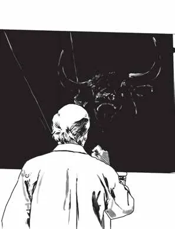

себя, лихорадочно пытающихся создать произведение искусства. Кровь капает у них из ушей, из уголков налитых кровью глаз и течёт из носа. Такие видения требуют проверки **Рассудка** (потеря 1/1d6).

Пеладану любопытно услышать, что увидено, но он не обязательно понимает, что видения буквальны, — он считает их метафорами. Сообразительный сыщик может предложить воспользоваться оккультной библиотекой Пеладана, чтобы разобраться в смысле видения. Пеладан сочтёт это превосходной мыслью.

Если Бенуа (готовый сыщик) испытает на себе действие обряда и ещё не понял, что Вирсавия изображена на картине Пино «5 000», он видит, как идёт по галерее, поднимает глаза на картину — и его глаза расширяются, когда он узнаёт образ Вирсавии. Проверка **ИНТ** позволяет узнать картину по её расплывчатому виду в видении, и Бенуа вспоминает, что она всё ещё висит в этой галерее. На картине изображён Христос, протягивающий хлеб коленопреклонённой женщине с лицом Вирсавии. Это проверка **Рассудка** (потеря 0/1d3): сыщик понимает, что только что исполнилось видение его собственного будущего. Учтите: если Бенуа уже связал Вирсавию с картиной, он получает видения по тем же правилам, что и остальные.

На этом Пеладан ведёт сыщиков обратно в особняк, оставив других членов Мистического ордена заканчивать дела в галерее.

## Сцена 4. Конец вечера

### Приход Пеладана

Время следующих событий зависит от того, что сыщики выбрали до сих пор. В галерею могут пойти не все сыщики. Пеладан (один или с сыщиками, которых он приводит из галереи) должен появиться одновременно с тем, как Пино найдут в уборной, или незадолго до этого.

Когда Пеладан входит в вестибюль, Коффье объявляет о нём, и многие гости выходят из гостиной и библиотеки, чтобы встретить его аплодисментами. Он начинает с того, что благодарит всех, кто пришёл на праздник, объявляет, что Салон имел огромный успех и что в следующие годы будут новые. Затем он сразу начинает говорить с каждым из гостей — если только ему не предложили разобраться в смысле видений в оккультной библиотеке: в этом случае он поднимается наверх. Ради драматического момента они должны обнаружить взломанные двери библиотеки (если Лаваня не остановили) в то же время, когда в уборной найдут Пино.

Прежде чем Пеладан уйдёт из вестибюля, с ним заговаривают Ла Раш и Вирсавия. Чтобы подслушать разговор, можно пройти проверку **Слуха**. Ла Раш представляет жену и извиняется за то, что не предоставил Салону скульптуру минотавра. Пеладан, поначалу явно рассерженный на Ла Раша, покорён красотой Вирсавии и прощает его. Ещё Ла Раш добавляет, что вернул книгу в оккультную библиотеку и, исполнив то, что она предлагала, добился большого успеха. Пеладану интересно, что это за успех, и Ла Раш зовёт его приехать к ним в дом в Туари через два дня (во вторник, 12 апреля). До тех пор он больше ничего не скажет.

### Смерть Пино

Пино не выходил из уборной с тех пор, как зашёл туда в 22:00. Успешная проверка **Слуха** позволит различить приглушённый плеск внутри, а затем звук, будто что-то шлёпнулось о другую сторону двери. Если подойти ближе, из-под двери тянет медным запахом крови.

Сыщики могут выломать дверь (достаточно успешной проверки **СИЛ**) или позвать Коффье, чтобы тот её отпер. Внутри они находят Пино, навалившегося на унитаз. Затылок у него взорван, осколки кости впились в потолок
