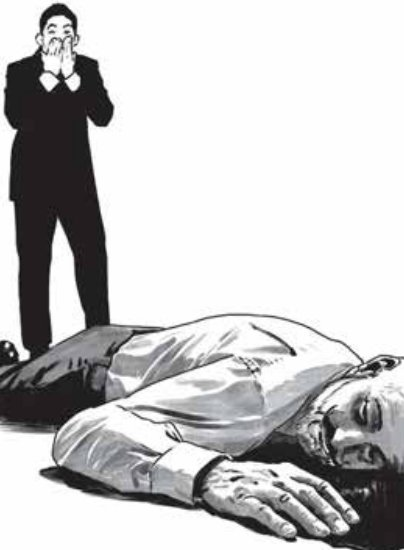

и в обратную сторону двери, тоже залитую кровью и мозговым веществом. Взрыв выпотрошил его голову изнутри. Это вызывает проверку **Рассудка** (потеря 1/1d6). Тот, у кого есть **Медицина** или **Первая помощь**, может определить, что входного отверстия нет. Мозг Пино будто взорвался и вылетел из головы.

Если сыщики действовали быстро, услышав звук взрыва головы Пино, Хранитель может назначить проверку **Удачи**. Успех означает, что сыщики ворвались вовремя, чтобы увидеть последнюю из **Муз из-за грани** (с. 70). Сыщик, вошедший в уборную, видит, как что-то движется в тени за телом. Если присмотреться, он замечает Музу — ромбовидный свет, который смещается и поворачивается, на секунду зависает в тенях и исчезает. Это вызывает проверку **Рассудка** (потеря 1/1d8).

Если сыщики сразу не помешают людям заглянуть внутрь, мимо открытой двери проходит горничная, видит тело, роняет поднос с напитками и кричит. На крик в коридор сбегаются все гости. Собравшиеся ахают и переглядываются в изумлении. Слышатся догадки — «убийство», «самоубийство», — пока Коффье велит одной из горничных немедленно вызвать жандармерию.

Пока через несколько минут не придёт жандармерия, Пеладан пытается успокоить гостей. Проверка **Психологии** или трудная проверка **Внимания** у того, кто вглядывается в лица в толпе, позволяет понять, что смерть Пино потрясла всех, кроме Вирсавии. Вирсавия просто смотрит с бесстрастным, отрешённым видом. Если позже спросить её об этом, она скажет лишь: «Смерть — неизбежная часть жизни. Трагедия, что умер талантливый человек, и трагедия, что вместе с ним умерло столько нерождённого искусства. То, что я не всегда показываю чувства, не значит, что я их не испытываю. Я буду оплакивать его по-своему». Успешная проверка **Психологии** после этого разговора оставляет сыщика в растерянности: он не уверен, была ли в этих словах хоть доля правды.

### Жандармерия

Через несколько минут приходят двое жандармов и осматривают место. Тут же вызывают детективов. Всех гостей просят собраться в библиотеке и ждать допроса в гостиной. Один из жандармов стоит у двери из библиотеки в коридор и следит за гостями.

Затем гостей по одному вызывают на допрос, а дав показания, каждый должен ждать в вестибюле. Первым вызывают Пеладана, за ним сыщиков. Детективы расспрашивают о событиях вечера вплоть до обнаружения тела. Хранителю стоит попросить каждого сыщика кратко изложить всё, в чём его рассказ детективам расходится с тем, что было на самом деле (то есть о чём он умалчивает, в чём прямо лжёт и т. п.).

Если сыщики укажут на кого-то (например, на Лаваня), Хранитель волен сам решить, как ответит жандармерия, и подумать, что придётся изменить в событиях следующих дней. Например, если сыщики расскажут о поступках Гийон за вечер (её переглядывание с Лаванем, то, как оба сверяли часы, упавший поднос, явно призванный заглушить звук взлома наверху, и т. д.), детективы вызывают на допрос Гийон. Под нажимом закона она тут же сдаётся и рассказывает о сделке с Лаванем. Это приводит к тому, что Лаваня увозят в участок для дальнейшего допроса, а его план подставить Придо полностью оборачивается против него самого.

Приезжает врач, чтобы осмотреть тело. Врач замечает, что никогда не видел ничего подобного. Входного отверстия нет, следов оружия тоже, поэтому самоубийство он исключает. Если это убийство, то хитроумное и не тем оружием, какое ему доводилось видеть. Первое его предположение — смерть от естественных причин, хотя потребуются дополнительные исследования в морге.

После допроса сыщиков первым из гостей детективы допрашивают Лаваня. Когда он выходит в вестибюль, один из детективов выходит из гостиной и идёт к гардеробу в конце коридора, ведущего к комнатам прислуги, где хранятся пальто гостей. Если план Лаваня удался, детектив возвращается с книгой, которую туда подложил Лавань («Évocations du Dieu intérieur»). Если книгу забрали
