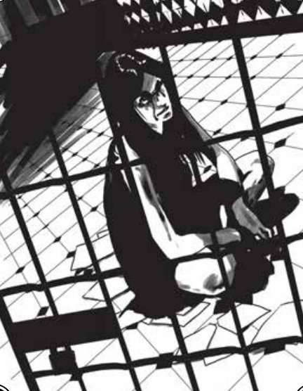

## Помощь персонажам Хранителя

Когда сыщики поймут, что происходит, они, возможно, захотят помочь художникам создать спасительное произведение. Придо охотнее примет помощь, чем Денерьяз или Лавань.

По правилам, если сыщики хотят помочь художнику, им нужен чрезвычайный успех в проверке **Искусства/ремесла**, чтобы показать, что они вносят в работу художника что-то ценное. Это даёт художнику бонусную кость на его проверку. Помогающий сыщик бросает 1d6, чтобы определить, сколько часов занимает работа, а затем после своей проверки бросает за художника его навык Искусство/ремесло, чтобы узнать, удалось ли тому. Если художник получит чрезвычайный успех, его произведение становится **Проявлением вдохновения** (с. 70).

Если так случится, у каждого из художников чернила стекают с записей и растекаются лужей по полу. Затем из неё начинает подниматься фигура, сотканная из самих чернил.

- **У Бюиссон:** фигура — стройная женщина в балетном платье.
- **У Лаваня:** фигура в средневековом облачении (может быть, даже в доспехах).
- **У Придо:** фигура — мужчина, одетый в духе традиционного облика апостола в искусстве Возрождения.
- **У Денерьяз:** фигура — прекрасная женщина со скрипкой.

*Примечание:* если сыщик получил чрезвычайный успех в проверке помощи, это не засчитывается для исполнения его собственного семени (если оно у него есть), поскольку это произведение не основано на полученном им видении.

### Последствия

Прорывы могут быть незаметными (например, у Бюиссон это может случиться, когда она одна в пустой больничной палате, а тело позже находит медсестра) или такими явными, как пожелает Хранитель (возвращаясь к тому же примеру — прорыв происходит в переполненной палате, и другие больные и медсёстры видят, как ужас разворачивается у них на глазах).

Если сыщики не общаются с некоторыми персонажами Хранителя, события происходят за кадром, но вести о них должны быстро доходить до сыщиков, если в ком-то из них ещё сидят семена вдохновения.

Долгие последствия этих смертей выходят за рамки сценария. Такая долгая линия может заинтересовать Хранителя, который использует сценарий как часть продолжающейся кампании. Поскольку смерти следуют одна за другой и все касаются членов Салона, а точнее тех, кто был на вечеринке в воскресенье вечером, газеты и жандармерия заинтересуются ими и обратят внимание на сыщиков. Это может дать зацепки для встреч, ведущих к другим сценариям.

## Семена вдохновения сыщиков

В течение дня после вечеринки сыщики должны понять, что их спасение — в том, чтобы дать волю творческому порыву и создать произведение искусства. Произведения, которые они создадут, и Проявления вдохновения, в которые те превратятся, описаны ниже.

Как они ведут себя после создания, см. в статье **«Проявление вдохновения»** (с. 70). В каждом случае создатель может позвать товарищей-сыщиков взглянуть на сотворённое. Если он это сделает, Проявлению стоит дождаться их прихода, а не отправляться сразу в мир сеять семена. Сколько сведений каждое Проявление сообщит сыщикам, целиком решает Хранитель.

Учтите, что каждый сыщик, создавший Проявление вдохновения, должен пройти проверку Рассудка (потеря 1/1d10).

### Кловис Эрбер

Кловис вдохновился написать женщину с новорождённым младенцем на руках. Провалы его проверок Искусства/ремесла — это картины, в которых цвет несовершенен или образ матери ему не
