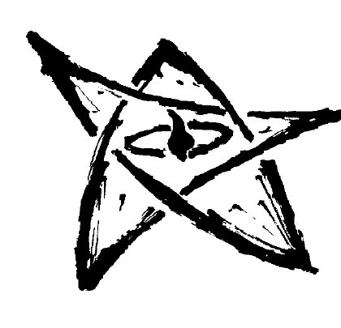

## Муза из-за грани

Обитатели запредельного, эти существа — источник художественного творчества человечества. Они словно состоят из мириад вечно меняющихся цветных огней и линий, которые изгибаются и поворачиваются в сводящем с ума зрелище, режущем глаза всем, кто на них смотрит. Это не только зрелище: свидетели ощущают в воздухе что-то неправильное, и волосы у них встают дыбом от холодка тревоги.

Муза может нападать только на существо, которое её почувствовало. Если у сыщика идут последние стадии прорастания **семени вдохновения** (с. 46), это может случиться, лишь когда сыщик заходит в тёмные места, где видеть Муз может только он один. Если Музы прорвались в результате неудавшегося прорастания, они могут бродить и нападать без этих ограничений, и видят их все присутствующие.

Прорвавшись в наш мир в результате неудавшегося прорастания, они не имеют ничего, что держало бы их здесь, и в конце концов гибнут через 1d10 раундов.

*Прим. перев.: во врезке «Семена вдохновения» (с. 46) срок другой — прорвавшиеся Музы остаются в нашем мире 1d10 минут.*

Музы не нападают просто так. Они кружатся и вертятся в воздухе, как лезвия, и с бритвенной остротой рассекают своих жертв.

### Музы из-за грани, астральные ужасы

```stat
СИЛ —     ВЫН —     ТЕЛ —     ЛВК 85    ИНТ 100
НАР —     МОЩ 75    ОБР —     Рассудок —     ПЗ 10
БкУ: 0    Комплекция: −2    Скорость: 9    ПМ: 15

Атак за раунд: 1
Вращающийся разрез    50% (25/10), урон 1d10
Уклонение             42% (21/8)

Броня: нет, но повредить её можно только магическими атаками.
Потеря Рассудка: 1/1d8 Рассудка за то, чтобы увидеть Музу из-за грани.
```



## Проявление вдохновения

Проявления не враждебны открыто. Если кто-то их разоблачит, они не ответят насилием, а попытаются использовать это разоблачение, чтобы вдохновить других. Отбиваются они, только если нападут на них самих или на человека, в котором зреет семя вдохновения. В зависимости от материала, из которого они сделаны, в рукопашной они могут оказаться смертельно опасными противниками.

Произведение искусства, которое они воплощают, ничем не ограничено. Однако некоторые произведения, оживи они, описать труднее, чем другие. Как правило, если это рисунок, текст, картина и т. п., Проявление принимает облик главного образа произведения. Если это статуя, то просто оживает сама статуя, что бы она ни изображала (хотя лучше всего — живое существо). Если двухмерное произведение изображает не существо (например, пейзаж), то материал, которым оно создано, складывается в копию художника. Если изображено животное, Проявление ведёт себя во многом как это животное, хотя и способно общаться.

### Проявления вдохновения, ожившие произведения искусства

```stat
СИЛ 80    ВЫН 70    ТЕЛ разная*    ЛВК 85    ИНТ 100
НАР —     МОЩ 75    ОБР —     Рассудок —     ПЗ 15
БкУ: разный**    Комплекция: разная    Скорость: 9    ПМ: 15

* ТЕЛ зависит от созданного предмета.
** бонус к урону зависит от материала: камень +1d6, дерево +1d4, краска или чернила — нет.

Атак за раунд: 1
Ближний бой (драка)   50% (25/10), урон 1d10 + бонус к урону (зависит от материала**)
Уклонение             42% (21/8)

Броня: нет. Однако если Проявление каменное, огнестрельное оружие наносит минимальный урон, а огонь и безоружные атаки не действуют. Другие материалы могут быть особенно уязвимы для некоторых атак — например, масляная краска для огня.
Навыки: все языки 100%.
Потеря Рассудка: 1/1d10 Рассудка за то, чтобы увидеть Проявление вдохновения.
```
