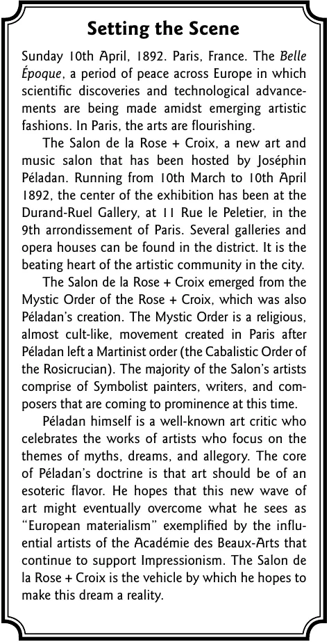

# Приложение B. Раздатки

> **Раздатка «Послание» 1**
>
> **Место действия**
>
> Воскресенье, 10 апреля 1892 года. Париж, Франция. *Прекрасная эпоха* — время мира по всей Европе, когда научные открытия и технические достижения совершаются среди рождающихся художественных течений. В Париже искусства процветают.
>
> Салон Розы и Креста — новый салон искусства и музыки, который устроил Жозефен Пеладан. Салон шёл с 10 марта по 10 апреля 1892 года; центром выставки была галерея Дюран-Рюэля на улице Ле Пелетье, 11, в IX округе Парижа. В округе несколько галерей и оперных театров; это бьющееся сердце художественной жизни города.
>
> Салон Розы и Креста вырос из Мистического ордена Розы и Креста — тоже создания Пеладана. Мистический орден — религиозное, почти культовое движение, созданное в Париже после того, как Пеладан покинул мартинистский орден (Каббалистический орден Розы и Креста). Большинство художников Салона — живописцы, писатели и композиторы-символисты, как раз входящие в силу.
>
> Сам Пеладан — известный художественный критик, превозносящий художников, которые обращаются к мифам, снам и аллегориям. Суть учения Пеладана — искусство должно быть эзотерическим. Он надеется, что эта новая волна искусства однажды одолеет то, что он считает «европейским материализмом», воплощённым влиятельными художниками Академии изящных искусств, которые по-прежнему поддерживают импрессионизм. Салон Розы и Креста — средство, которым он надеется воплотить эту мечту.
