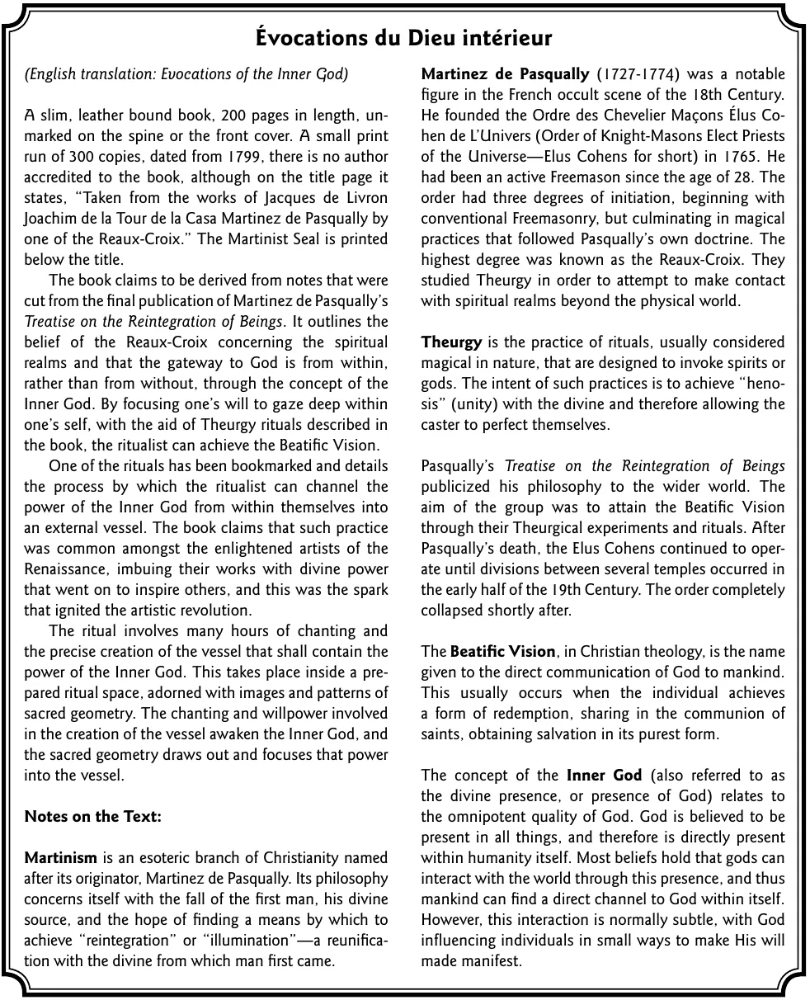

> **Раздатка «Послание» 2**
>
> **Évocations du Dieu intérieur**
>
> *(В переводе: «Воззвания к Внутреннему Богу»)*
>
> Тонкая книга в кожаном переплёте, 200 страниц, без надписей на корешке и обложке. Небольшой тираж в 300 экземпляров, датирована 1799 годом; автор у книги не указан, но на титульном листе сказано: «Из трудов Жака де Ливрона Жоакима де ла Тур де ла Каса Мартинеса де Паскуалли, одним из Рео-Круа». Под заглавием напечатана мартинистская печать.
>
> Книга утверждает, что составлена из заметок, вырезанных из окончательного издания «Трактата о реинтеграции существ» Мартинеса де Паскуалли. Она излагает учение Рео-Круа о духовных сферах и о том, что врата к Богу находятся внутри, а не вовне, — через понятие Внутреннего Бога. Сосредоточив волю, чтобы заглянуть глубоко в себя, с помощью описанных в книге теургических обрядов ритуалист может достичь Блаженного видения.
>
> Один из обрядов заложен закладкой; он описывает, как ритуалист может направить силу Внутреннего Бога изнутри себя во внешний сосуд. Книга утверждает, что так обычно поступали просвещённые художники Возрождения, наделяя свои произведения божественной силой, которая затем вдохновляла других, — и это была искра, зажёгшая художественную революцию.
>
> Обряд требует многих часов песнопений и точного создания сосуда, который вместит силу Внутреннего Бога. Он проходит в подготовленном ритуальном пространстве, украшенном изображениями и узорами священной геометрии. Песнопения и сила воли, вложенные в создание сосуда, пробуждают Внутреннего Бога, а священная геометрия вытягивает эту силу и сосредоточивает её в сосуде.
>
> **Примечания к тексту:**
>
> **Мартинизм** — эзотерическая ветвь христианства, названная по имени основателя, Мартинеса де Паскуалли. Его философия занята падением первого человека, его божественным источником и надеждой найти путь к «реинтеграции» или «просветлению» — воссоединению с божественным, из которого человек вышел.
>
> **Мартинес де Паскуалли** (1727–1774) — заметная фигура французского оккультизма XVIII века. В 1765 году он основал Орден рыцарей-масонов избранных коэнов Вселенной (Ordre des Chevelier Maçons Élus Cohen de L’Univers; сокращённо — Избранные коэны). Деятельным масоном он был с 28 лет. В ордене было три степени посвящения: начинались они с обычного масонства, а завершались магическими практиками по собственному учению Паскуалли. Высшая степень называлась Рео-Круа. Они изучали теургию, пытаясь установить связь с духовными сферами за пределами физического мира.
>
> **Теургия** — практика обрядов, обычно считающихся магическими, предназначенных для призыва духов или богов. Цель таких практик — достичь «хенозиса» (единства) с божественным и тем самым позволить совершающему обряд усовершенствовать себя.
>
> «Трактат о реинтеграции существ» Паскуалли открыл его философию миру. Целью группы было достичь Блаженного видения теургическими опытами и обрядами. После смерти Паскуалли Избранные коэны продолжали действовать, пока в первой половине XIX века между несколькими храмами не произошли расколы. Вскоре после этого орден окончательно распался.
>
> **Блаженное видение** в христианском богословии — так называют прямое общение Бога с человеком. Обычно оно случается, когда человек достигает своего рода искупления, приобщаясь к общению святых, обретая спасение в чистейшем виде.
>
> Понятие **Внутреннего Бога** (его также называют божественным присутствием, или присутствием Бога) связано со всемогуществом Бога. Считается, что Бог присутствует во всём, а значит, непосредственно присутствует и в самом человечестве. Большинство верований полагает, что боги могут воздействовать на мир через это присутствие, и поэтому человечество может найти прямой путь к Богу в себе самом. Однако обычно это воздействие едва заметно: Бог влияет на людей по мелочам, чтобы его воля проявилась.
