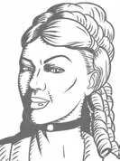

## Эдвина Александер, дилетантка, 30 лет



```stat
СИЛ 40    ВЫН 50    ТЕЛ 50    ЛВК 70    ИНТ 50
НАР 80    МОЩ 60    ОБР 60    Рассудок 60    ПЗ 10
БкУ: 0    Комплекция: 0    Скорость: 8    Удача: 50

Ближний бой (драка)   25% (12/5), урон 1d3
Уклонение             35% (17/7)

Навыки: Искусство/ремесло (рисунок) 50%, Обаяние 70%, Средства 50%, Стрельба (пистолет) 40%, Иностранный язык (французский) 40%, Родной язык (английский) 60%, Слух 40%, Оккультизм 50%, Убеждение 60%, Психология 30%, Верховая езда 40%, Внимание 45%, Скрытность 60%.
```

**Предыстория:**

- Описание: вьющиеся волосы, дорогое платье с глубоким вырезом, почти скандальное для своего времени.
- Черты: хитрая и уверенная в себе.

Вы — известное лицо в художественных кругах Парижа и Лондона, английская дилетантка, вращающаяся в кругах, очень похожих на Мистический орден, где сплетаются оккультизм и искусство. Дитя богатой семьи, вы никогда ни в чём не нуждались. Когда вы проявили интерес к рисованию, вам наняли в учителя лучших художников Лондона. Детство было обеспеченным, но в остальном скучным. Поэтому вы сбежали из дома, как только смогли, и отправились познавать мир.

Вы ищете ответы, ищете смысл всего сущего. Вы поняли, что общепринятая религия не хранит тайн мироздания, а вот оккультизм обещает кое-какие ответы. Вы слышали о Мистическом ордене и о том, что у Пеладана собрано множество оккультных сведений. Может быть, там вы найдёте ответ на то, как всё началось и откуда произошло человечество.

За последний месяц вы много раз бывали в галерее и сумели поговорить с Пеладаном, и он пригласил вас на вечеринку по случаю закрытия Салона Розы и Креста. Вечеринка пройдёт в особняке Пеладана в центре Парижа, недалеко от галереи. Там будут видные художники Салона, а также его покровители и те, кто хочет потереться среди парижской элиты. Вы надеетесь пустить в ход своё обаяние, чтобы Пеладан принял вас в Мистический орден и открыл вам доступ к своей оккультной библиотеке, которая, по слухам, одна из лучших в Париже.

**Ваши товарищи-сыщики:**

**Джейн Харнсворт-Райт:** уважаемая лондонская торговка произведениями искусства; часто приезжает в Париж, чтобы покупать новые работы и выставлять или продавать их в своих галереях в обоих городах.

**Кловис Эрбер:** художник, отчасти известный. Он принадлежит к школе реализма; его взгляд устремлён далеко вперёд, но его любимый стиль критики Салона считают отсталым и устаревшим.

**Донасьен Бенуа:** художественный критик, постоянно пишущий для популярных парижских журналов. Человек, известный своим влиянием в мире искусства и жёсткой критикой «недостойного» искусства.

**Рене Рошфор:** журналист с репутацией человека, способного разнюхать грязь в высшем обществе. Меньше всего вам нужен скандал на пути, так что лучше приглядывать за ним, если решите тайком забрать книги Пеладана.

**Вивиан Эно:** покровительница искусств из старинной богатой семьи; за последние годы она поддержала многие набирающие силу художественные течения. Возможно, могущественная союзница в художественных кругах.
