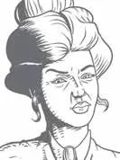

## Джейн Харнсворт-Райт, торговка произведениями искусства, 38 лет



```stat
СИЛ 50    ВЫН 50    ТЕЛ 40    ЛВК 50    ИНТ 70
НАР 60    МОЩ 60    ОБР 80    Рассудок 60    ПЗ 9
БкУ: 0    Комплекция: 0    Скорость: 9    Удача: 45

Ближний бой (драка)   25% (12/5), урон 1d3
Уклонение             45% (22/9)

Навыки: Оценка 70%, Искусство/ремесло (рисунок) 50%, Средства 60%, История 50%, Работа в библиотеке 60%, Иностранный язык (французский) 50%, Родной язык (английский) 80%, Юриспруденция 40%, Слух 40%, Убеждение 40%, Психология 30%, Внимание 40%.
```

**Предыстория:**

- Описание: невысокая и стройная, в роскошном платье и дорогих украшениях.
- Черты: утончённость высшего общества.

Вы упорно трудились, чтобы достичь своего положения, и никому не позволите его отнять. Вы жена Томаса Харнсворт-Райта, лондонского торговца произведениями искусства; вы занялись его делом и затмили его своим успехом. Теперь он ведёт лондонскую контору, а вы разъезжаете по континенту, приобретая новые работы у восходящих художников, чтобы выставлять их в Лондоне и Париже.

Пеладан пригласил вас на вечеринку по случаю закрытия Салона Розы и Креста в своём особняке в центре Парижа, недалеко от галереи, где проходил Салон. Там будут видные художники Салона, а также его покровители и те, кто хочет потереться среди парижской элиты. Читая между строк, вы думаете, что он надеется: вы сумеете заключить с художниками сделки и показать их работы в Лондоне, что послужит и его собственным замыслам насчёт Салона.

Из разговора с Полем Дюран-Рюэлем (владельцем галереи, где проходила выставка Салона) вы знаете, что там будет один художник, который вас особенно интересует: Антонен Пино, живописец несомненного мастерства. Одна из его картин, выставленных в Салоне, вызвала огромный интерес. «Человек и бык» изображает минотавра, который крадётся по своему подземному логову. Издали картина выглядит чёрным прямоугольником, но вблизи начинают проступать тонкие подробности. Это шедевр, не похожий ни на что из виденного Парижем. Вы знаете, что на открытом рынке он принесёт высокую цену, поэтому главная ваша цель на вечеринке — купить у Пино эту картину, а может быть, и будущие его работы, пока он не стал широко известен.

**Ваши товарищи-сыщики:**

**Эдвина Александер:** английская дилетантка, вращающаяся в кругах, очень похожих на Мистический орден, где сплетаются оккультизм и искусство.

**Кловис Эрбер:** художник, отчасти известный. Он принадлежит к школе реализма; его взгляд устремлён далеко вперёд, но его любимый стиль критики Салона считают отсталым и устаревшим.

**Донасьен Бенуа:** художественный критик, постоянно пишущий для популярных парижских журналов. Человек, известный своим влиянием в мире искусства и жёсткой критикой «недостойного» искусства.

**Рене Рошфор:** журналист средней руки, пишущий о светской жизни Парижа. Он не художественный критик, как Бенуа, и, пожалуй, куда более приятный человек; у него могут найтись интересные сплетни о Салоне, которыми вы могли бы воспользоваться.

**Вивиан Эно:** покровительница искусств из старинной богатой семьи; за последние годы она поддержала многие набирающие силу художественные течения. Возможно, её заинтересуют некоторые работы из вашего нынешнего собрания.
