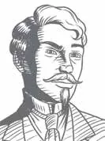

## Кловис Эрбер, художник, 42 года



```stat
СИЛ 50    ВЫН 70    ТЕЛ 50    ЛВК 80    ИНТ 60
НАР 40    МОЩ 60    ОБР 60    Рассудок 60    ПЗ 12
БкУ: 0    Комплекция: 0    Скорость: 8    Удача: 50

Ближний бой (драка)   25% (12/5), урон 1d3
Уклонение             40% (20/8)

Навыки: Искусство/ремесло (живопись) 70%, Средства 40%, Красноречие 40%, История 60%, Иностранный язык (английский) 21%, Родной язык (французский) 60%, Работа в библиотеке 50%, Слух 40%, Механика 60%, Оккультизм 25%, Убеждение 40%, Психология 50%, Внимание 50%.
```

**Предыстория:**

- Описание: волнистые волосы, длинные усы и остроконечная бородка, поношенный тёмный костюм.
- Черты: чудак.

У вас есть талант, этого никто не оспаривает, но манеру, в которой вы выражаете своё искусство, и публика, и критики отвергли ради новой волны искусства, поднимающейся в Париже. Для вас, как для приверженца реализма, высшие произведения искусства — те, что отражают жизнь как можно точнее. Мастерство, нужное, чтобы воспроизвести природу, как в «Давиде» Микеланджело, превосходит дикие и грубые мазки тех, кто сегодня называет себя художниками.

Вы ищете способ выставить свои работы, а ещё лучше — продать их ценителям. Для этого вы задействовали все связи, какие могли, и через своего друга Антонена Пино (одного из художников Салона) сумели получить приглашение на вечеринку по случаю закрытия Салона Розы и Креста в особняке Пеладана в центре Парижа, недалеко от галереи, где проходил Салон. Там будут видные художники Салона, а также его покровители и те, кто хочет потереться среди парижской элиты.

Публика там не самая подходящая для вас — сплошь символисты. Однако там могут быть торговцы картинами, и если вы убедите Пеладана выставить какие-то ваши работы, то наконец сможете сделать себе имя. Возможно, придётся подстроиться под его эзотерические темы, но вы хотя бы сможете подать их как можно более «реально». Говорят, именно так попал в Салон другой ваш друг, Пьер Ла Раш, хотя в итоге он так ничего и не выставил из-за бурного романа и женитьбы. Ходят слухи, что он и его прекрасная жена будут сегодня на вечеринке.

**Ваши товарищи-сыщики:**

**Эдвина Александер:** английская дилетантка, вращающаяся в кругах, очень похожих на Мистический орден, где сплетаются оккультизм и искусство.

**Джейн Харнсворт-Райт:** уважаемая лондонская торговка произведениями искусства; часто приезжает в Париж, чтобы покупать новые работы и выставлять или продавать их в своих галереях в обоих городах. Может быть, её заинтересуют ваши работы?

**Донасьен Бенуа:** художественный критик, постоянно пишущий для популярных парижских журналов. Человек, известный своим влиянием в мире искусства и жёсткой критикой «недостойного» искусства. По крайней мере, о вашем искусстве он плохо не отзывался.

**Рене Рошфор:** журналист, работающий на парижские газеты. Он пишет о художественной и светской жизни. Он не критик, как Бенуа, и, если привлечь его на свою сторону, может сделать вам рекламу получше.

**Вивиан Эно:** покровительница искусств из старинной богатой семьи; за последние годы она поддержала многие набирающие силу художественные течения. Удастся ли убедить её вложиться в ваши творения?
