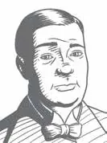

## Донасьен Бенуа, художественный критик, 43 года



```stat
СИЛ 60    ВЫН 40    ТЕЛ 50    ЛВК 50    ИНТ 60
НАР 50    МОЩ 80    ОБР 70    Рассудок 80    ПЗ 9
БкУ: 0    Комплекция: 0    Скорость: 8    Удача: 60

Ближний бой (драка)   25% (12/5), урон 1d3
Уклонение             25% (12/5)

Навыки: Искусство/ремесло (литература) 50%, Средства 50%, Красноречие 25%, История 30%, Запугивание 60%, Иностранный язык (английский) 40%, Родной язык (французский) 70%, Работа в библиотеке 40%, Слух 40%, Оккультизм 40%, Психология 50%, Внимание 45%.
```

**Предыстория:**

- Описание: несколько полноват, но крепок, короткие волосы, хороший костюм, в руке — трость джентльмена.
- Черты: безграничное высокомерие.

Вы — талантливый литератор. Вы пишете для популярных журналов о парижской жизни, обладаете немалым влиянием в художественных кругах и постоянно публикуете критические отзывы о выставках и салонах, которые проходят в городе.

Людям нравятся ваши статьи — как и должно быть! Вы влияли на то, кто преуспеет, а кто провалится, в большинстве художественных начинаний Парижа. Видя такую власть, люди приходили к вам за помощью в построении карьеры, а порой — чтобы уничтожить тех, кто их затмил. Вас ничуть не удивляет, что вас пригласили на вечеринку по случаю закрытия Салона Розы и Креста в особняке Пеладана в центре Парижа, недалеко от галереи, где проходил Салон. Там будут видные художники Салона, а также его покровители и те, кто хочет потереться среди парижской элиты. Пеладан, несомненно, напрашивается на хвалебный отзыв. Хотя некоторые работы были несколько фантастичны, их качество исключительно.

Однако до вас дошло, что за кулисами этой в остальном успешной выставки между членами Салона возникли трения. Вы хотите узнать, в чём дело, и извлечь из этого любую выгоду, какую сможете. Где соперничество — там история, а где история — там кто-то захочет заплатить, чтобы в вашем репортаже отразилась именно его сторона. Выжмите всё, что могут предложить обе стороны.

**Ваши товарищи-сыщики:**

**Эдвина Александер:** английская дилетантка, вращающаяся в кругах, очень похожих на Мистический орден, где сплетаются оккультизм и искусство. Говорят, она ещё и рисует наброски как любительница. По-вашему, её работы посредственны.

**Джейн Харнсворт-Райт:** уважаемая лондонская торговка произведениями искусства; часто приезжает в Париж, чтобы покупать новые работы и выставлять или продавать их в своих галереях в обоих городах.

**Кловис Эрбер:** художник, хотя едва ли заметный. Реалист, технически хороший живописец, но предпочитает устаревшие стили, которые большинство критиков считает отсталыми и устаревшими. Вы уже писали о его работах нейтральную рецензию.

**Рене Рошфор:** журналист, мнящий себя писателем. Будь его сочинения хоть чего-то стоящими, их бы уже напечатали. Хотя вы прежде всего критик, вы пишете для газет и журналов, а значит, формально он ваш соперник. Какую историю он здесь ищет?

**Вивиан Эно:** покровительница искусств из старинной богатой семьи; за последние годы она поддержала многие набирающие силу художественные течения. Само воплощение декаданса: она плывёт по течению, пока ей что-нибудь не наскучит, и тогда переключается на другое. Вы о ней не слишком высокого мнения.
