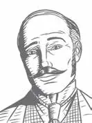

## Рене Рошфор, журналист, 46 лет



```stat
СИЛ 60    ВЫН 40    ТЕЛ 50    ЛВК 80    ИНТ 60
НАР 50    МОЩ 70    ОБР 50    Рассудок 70    ПЗ 9
БкУ: 0    Комплекция: 0    Скорость: 9    Удача: 50

Ближний бой (драка)   45% (22/9), урон 1d3
Уклонение             40% (20/8)

Навыки: Искусство/ремесло (литература) 60%, Обаяние 40%, Средства 20%, Красноречие 60%, Ближний бой (драка) 45%, История 40%, Работа в библиотеке 50%, Слух 50%, Иностранный язык (английский) 50%, Родной язык (французский) 50%, Психология 70%, Внимание 60%, Скрытность 30%.
```

**Предыстория:**

- Описание: лысеющий, остроконечные усы, деловой костюм с безупречной рубашкой и аккуратно повязанным галстуком.
- Черты: сосредоточенный и наблюдательный.

Вы хотели стать писателем, пойти по стопам таких, как талантливый Ги де Мопассан, но обнаружили, что пробиться на этот рынок очень трудно: он, похоже, открыт лишь немногим, кто вращается в нужных кругах. Однако слова всё же открывали вам двери, и вы стали журналистом парижских газет — ведёте колонки о высшем обществе, искусстве и злободневных делах культурной элиты города. Летописец золотого века, *Прекрасной эпохи*, из первых рук, сейчас вы работаете в «Ле Матен», правой ежедневной газете.

Вы следили за Салоном Розы и Креста. Ни для кого не секрет, что он связан с Мистическим орденом Розы и Креста, но чем на самом деле занимается орден, всё ещё отчасти тайна. Разоблачение его внутренних дел стало бы блестящей статьёй. Кроме того, в Салоне уже есть несколько писателей, и если Пеладану понравятся ваши работы, возможно, вы убедите его, что могли бы внести вклад в следующий Салон. Вам могли бы помочь такие писатели, как Максимильен Лавань или поэтесса Эме Придо (по слухам, член Мистического ордена).

Если не удастся убедить их одним талантом, можно и поторговаться. Вы слышали, что в Салоне, возможно, есть внутренние раздоры. Будет очень жаль, если это попадёт в газеты. Вы могли бы проследить, чтобы этого не случилось. А взамен было бы очень любезно с их стороны включить кое-что из ваших работ в следующий Салон. Обычно вы не опускаетесь до таких низких приёмов, но это, возможно, ваш единственный шанс оставить свой след.

**Ваши товарищи-сыщики:**

**Эдвина Александер:** английская дилетантка, вращающаяся в кругах, очень похожих на те, что любят Салон и Мистический орден. Возможно, она знает больше о внутренних делах Мистического ордена.

**Джейн Харнсворт-Райт:** уважаемая лондонская торговка произведениями искусства; часто приезжает в Париж, чтобы покупать новые работы и выставлять или продавать их в своих галереях в обоих городах.

**Кловис Эрбер:** умеренно талантливый художник. Похоже, ему не удалось произвести впечатление, нужное, чтобы стать известным в художественных кругах. Его связи с художниками Салона могут дать ему представление о предполагаемых раздорах.

**Донасьен Бенуа:** видный художественный критик, чей язык, говорят, острее бритвы, когда он высказывается о художниках своего времени. Он вращается в кругах, не так уж непохожих на ваши, и, возможно, пришёл сюда за тем же, что и вы. Лучше докопаться до правды раньше него.

**Вивиан Эно:** покровительница искусств из старинной богатой семьи; за последние годы она поддержала многие набирающие силу художественные течения, в том числе Салон. Возможно, она знает кое-что о том, что разворачивается за кулисами, но, поскольку это может повредить её вложениям в Салон, вряд ли охотно что-то подтвердит.
