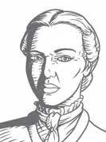

## Вивиан Эно, покровительница искусств, 35 лет



```stat
СИЛ 50    ВЫН 50    ТЕЛ 50    ЛВК 60    ИНТ 50
НАР 60    МОЩ 60    ОБР 80    Рассудок 60    ПЗ 9
БкУ: 0    Комплекция: 0    Скорость: 9    Удача: 55

Ближний бой (драка)   25% (12/5), урон 1d3
Уклонение             30% (15/6)

Навыки: Искусство/ремесло (скульптура) 40%, Оценка 50%, Средства 90%, Стрельба (пистолет) 50%, Запугивание 50%, Иностранный язык (английский) 40%, Родной язык (французский) 80%, Юриспруденция 50%, Слух 40%, Убеждение 50%, Психология 30%, Верховая езда 40%, Внимание 45%.
```

*Прим. перев.: ПЗ 9 и Скорость 9 — как в оригинале; по правилам (ВЫН 50 + ТЕЛ 50) / 10 = 10 ПЗ, а Скорость 8 (ЛВК больше ТЕЛ, СИЛ равна ТЕЛ).*

**Предыстория:**

- Описание: красивая, короткие волосы, обычного сложения, одета так, чтобы производить впечатление.
- Черты: властная.

Вы из старинной богатой семьи и окружили себя всем лучшим в жизни, но это стало вам надоедать, и вы принялись искать новое. Вы стали тратить деньги на искусство, приносящее в мир новое и прекрасное. Со временем вы сосредоточились на новейших, передовых талантах и школах, складывающихся в художественных кругах. Поэтому, когда представилась возможность финансировать новообразованный Салон Розы и Креста, вы ухватились за неё. Символисты были чем-то новым, странным и волнующим. Как тут устоять?

Салон только что закрылся, и в прессе говорят о его успехе у критиков. Однако ходят слухи, что в раю неладно. Между некоторыми художниками нарастают трения, которые могут вызвать дурную огласку. Доминик Денерьяз (музыкантша) и Жюстин Бюиссон (хореограф и танцовщица) едва сдерживают презрение друг к другу, работая вместе над постановкой музыки и танца для сцены. Какие ещё разногласия могут скрываться под поверхностью? Сегодня на вечеринке будут все, и вы надеетесь выявить источники неприятностей и не дать им выйти из-под контроля.

Вам нужно успокоить страсти, пока ваши вложения под угрозой. Дело не в том, что вы не можете позволить себе потерять деньги, выделенные Салону, — вы хотите, чтобы никому не сходило с рук подобное поведение.

**Ваши товарищи-сыщики:**

**Эдвина Александер:** английская дилетантка, вращающаяся в кругах, очень похожих на Мистический орден, где сплетаются оккультизм и искусство. Вы не слышали, чтобы она тоже поддерживала Салон деньгами. Что ей здесь нужно?

**Джейн Харнсворт-Райт:** уважаемая лондонская торговка произведениями искусства; часто приезжает в Париж, чтобы покупать новые работы и выставлять или продавать их в своих галереях в обоих городах. Было бы хорошо передать ей кое-какие работы Салона, чтобы его слава распространилась за море, в Англию.

**Кловис Эрбер:** художник, отчасти известный. Он принадлежит к школе реализма; его взгляд устремлён далеко вперёд, но его любимый стиль критики Салона считают отсталым и устаревшим.

**Донасьен Бенуа:** художественный критик, любящий ранить людей словами. Вы не жалуете таких, как он. Однако при нём безопаснее делать хорошую мину, чтобы он не обратил свой острый как бритва язык против вас, когда будет писать для журналов. Это могло бы серьёзно навредить делу Салона.

**Рене Рошфор:** журналист, мнящий себя писателем. Будь его сочинения хоть чего-то стоящими, их бы уже напечатали. Пока его не издадут как настоящего писателя, он немногим лучше обычного репортёра.
