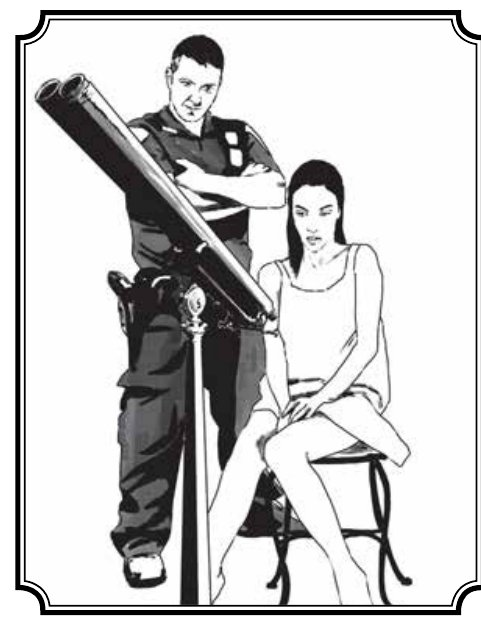

какое-то время, прежде чем человек действительно поймёт, на что смотрит. А потом — бам! — это бьёт по разуму, как товарный поезд, и человек пошатывается, пытаясь удержаться за реальность. Его разум внезапно настраивается на Великий Разум, и он постигает вселенную так, как прежде и помыслить не мог. Прикосновение к Великому Разуму можно сравнить с тем, как если бы тебе показали четвёртое измерение или ты услышал глас Божий.

Не всякий способен вынести этот опыт. Некоторые ломаются. Те, кто не сломался, обретают понимание мира и своего места в нём. Это понимание придаёт им сил, и они сразу же начинают видеть, что всё это время делали неправильно. Какова бы ни была их профессия или призвание, они внезапно становятся в своём деле лучше. Со временем они могут стать ведущими мастерами своей области. Каждый по-своему исследует и расширяет свои умения и знания, дарованные ему Великим Разумом. Каждый продвигается вперёд в своей области искусства и науки, и однажды, уже скоро, они соберутся вместе, чтобы поделиться знаниями на благо человечества. Тогда содержимое их умов будет сопоставлено, и для всего человечества родится новая эра. Как писал Лавкрафт в 1926 году:

> *Науки, каждая из которых тянет в свою сторону, до сих пор причиняли нам мало вреда; но однажды соединение разрозненных знаний откроет столь ужасающие картины реальности и нашего страшного положения в ней, что мы либо сойдём с ума от этого откровения, либо бежим от света в покой и безопасность нового тёмного века.*
>
> — Г. Ф. Лавкрафт, «Зов Ктулху»

А есть те, кто ломается. Для них Великий Разум слишком ярок, его прикосновение обжигает их разум и оставляет их увечными. Побочные действия проявляются у Сломленных по-разному. Некоторые становятся буйными и разрушительными, и их приходится связывать. Таких запирают, чтобы ведущие учёные города ставили на них опыты, или забивают как жертвы Великому Разуму. У других побочные действия не столь тяжелы, и их держат рабами, выполняющими чёрную работу и мелкие поручения, на которые иначе пришлось бы тратить время Благословенным.

Каждую ночь всё больше людей смотрит в телескоп. С каждым днём Благословенные всё крепче держат город в руках, и всё больше его хозяйства держится на рабах-Сломленных. Любые просьбы о помощи извне, обращённые к соседним городкам или городам, оставляют без ответа, как только звонят в полицию Стоуэлла, а та стремится подавить любое несогласие. Благословенным важно, чтобы проезжим и жителям соседних городков жизнь в Стоуэлле казалась нормальной. Лицо Стоуэлла для посторонних — например, автозаправки и закусочные — уже по большей части в их руках.

## Сыщики

Игра начинается через две недели после того, как профессор Харт впервые вступил в контакт с Великим Разумом. События нарастали постепенно, но теперь приближаются к кульминации. За последние несколько дней в жизни каждого из сыщиков что-то случилось. Только теперь они начинают понимать, что творится что-то очень неладное.

Для готовых сыщиков даны шесть предысторий (см. «Приложение B. Раздатки»). Каждая раздатка повторена ниже вместе с примечанием для Хранителя о том, что произошло на самом деле. В разделе ниже («Давление на игроков», см. с. 88) Хранитель найдёт идеи о том, как развивать эти события и вплетать их в игру.

### Сведения для Хранителя о готовых сыщиках

#### Уэсли Фрост (готовый сыщик)

Гленда Фергюсон, сестра Уэсли Фроста, живёт в городе. В воскресенье после церкви она с семьёй поехала к дому профессора Харта, и каждый посмотрел в телескоп. И сестра, и её муж теперь Сломленные, а их двенадцатилетние дочери-близнецы, Ширли и Максин, обе Благословенные.

Гленда стала почти безмозглой, а вот Дональд, её муж, стал опасен, и его усыпили
