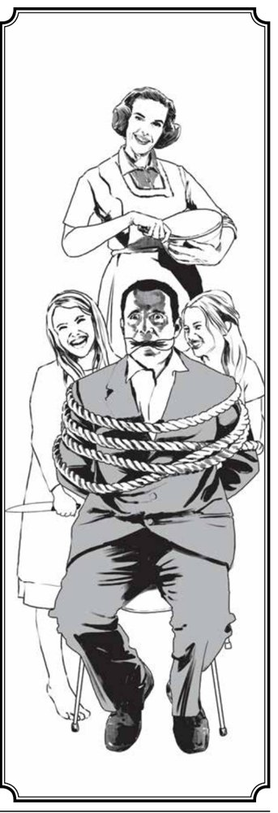

и заперли в подвале. Ширли и Максин увлекаются природой. Раньше они занимались цветами и птицами, а теперь изучают анатомию. Анатомию человека. Анатомию своего отца. Успокоительные притупляют его боль, и крики Дональда едва слышны с улицы. Со временем девочкам понадобятся новые образцы. Они заполняют подвал опытами и вскрытиями, а их мать тем временем печёт на кухне торты.

Если к ним заглянуть, дверь откроет Гленда и пригласит гостей на кофе с тортом. Держится она безучастно, но вежливо. Знакомые гости могут заметить, что домашних животных нет (их уже вскрыли). Вскоре появятся Ширли и Максин с доской, на которой они вскрыли лягушку. Они с воодушевлением втянут гостей в разговор о лягушке, чтобы проверить их знания. Если у гостя есть чему поучиться, девочки так и сделают; если нет — попытаются либо выпроводить гостя, либо схватить его для будущих опытов.

Если Гленду схватить и выпытывать у неё сведения, она ничего не скажет о профессоре Харте или телескопе (ей так велели). Девочки — Благословенные, поэтому о профессоре тоже ничего не расскажут.

> **Готовые сыщики**
>
> Для игры даны шесть готовых сыщиков (см. «Приложение C. Готовые сыщики», с. 104), однако сценарий легко приспособить для групп, которые хотят играть уже существующими персонажами, — в таком случае сыщики, скорее всего, «приезжие».
>
> Если вы создаёте сыщиков с нуля, раздайте каждому игроку по одной предыстории сыщика (см. «Приложение B. Раздатки») и предложите вплести её в историю своего сыщика. Профессии сыщиков могут быть любыми, какие ожидаешь встретить в провинциальном американском городке, но лучше, чтобы они не занимали высоких властных постов.
>
> Если играют новые сыщики, каждый из которых живёт в городе, — что сводит их вместе в одну группу? Это отчасти зависит от того, каких сыщиков они выберут. Они могут быть школьными друзьями, собутыльниками, петь в одном хоре, ходить в одну церковь и так далее.
>
> В зависимости от игроков вы можете сами определить, что связывает сыщиков, но, пожалуй, лучше и интереснее задать этот вопрос игрокам и дать им решить всей группой. Запомните важные подробности и постарайтесь вплести их в историю.

