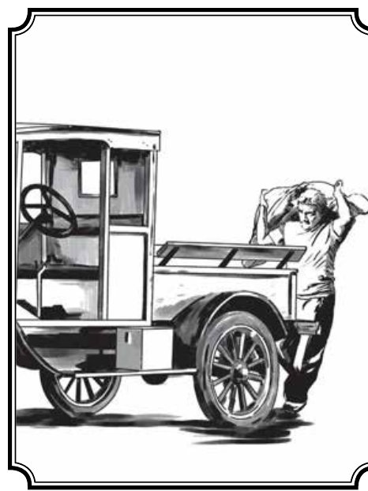

проходит, тем хуже становится положение, ведь всё больше горожан навещает профессора Харта. Другой вариант — нагнетать события, как описано в разделе «Давление на игроков» (с. 88).

## Расследование и улики

Возможных путей через этот сценарий слишком много, чтобы описывать здесь каждый. В сценарии используется сравнение со слоями луковицы: профессор Харт и его телескоп — в сердцевине луковицы. Как бы игроки ни вели расследование, им, скорее всего, придётся пройти ряд слоёв, примерно таких, как описано ниже. Старайтесь нагнетать интригу и угрозу и подбрасывать улики, ведущие к следующему слою луковицы.

### Внешний слой луковицы: встреча с другими встревоженными горожанами

Не только сыщики столкнулись со странными событиями, которые происходят в городе. Есть много обычных горожан, которые не стали ни Благословенными, ни Сломленными, но чью жизнь всё это затронуло. Возможно, у них есть родитель, ребёнок или супруг, который стал Благословенным и теперь изменился — или стал Сломленным и исчез, был обращён в рабство или просто сидит дома и пускает слюни. Возможно, они ищут пропавших (обычно детей или пожилых родственников), ставших добычей опасных убийц из числа Сломленных.

Встречи со встревоженными горожанами скорее всего приведут к встречам со Сломленными (слой 2) или, может быть, с Благословенными (слой 3).

### Второй слой: встреча со Сломленными

Сломленные бывают разными. Некоторые доведены до отчаяния — возможно, сбежали от хозяев. Некоторые — обезумевшие убийцы, которые охотятся на беспечных, обычно нападая на детей или стариков. Самые надёжные рабы — те, кто беспрекословно следует за хозяевами-Благословенными. Их можно встретить на службе у Благословенных, но и у них бывают проблески сознания, когда им хочется свободы. Фредди Дженсену поручено выслеживать беглых рабов, и он не знает к ним жалости.

Встречи со Сломленными, скорее всего, приведут к столкновению с Благословенными (слой 3). Из-за безумия или страха Сломленные вряд ли станут откровенно рассказывать о профессоре и телескопе, но вполне могут обронить намёки на «глаз в небе», «ужас со звёзд» или «Великий Разум!». На лицах некоторых Сломленных могут быть заметны следы телесных травм вокруг глаза, который они прижимали к телескопу: катаракта, язвы, налитые кровью глаза, синяки и тому подобное.

### Третий слой: встреча с Благословенными

У большинства Благословенных есть личная цель, и все они заняты каким-нибудь исследованием. Не всегда видно, что их занятие хоть сколько-нибудь научно, а иногда — что оно хотя бы разумно. Некоторые Благословенные целыми днями пекут один и тот же торт снова и снова, другие слушают пение птиц или журчание воды, третьи разными способами изучают людей (снаружи и изнутри).

Если с Благословенным заговорить, он ненадолго прервёт исследование, чтобы побеседовать с сыщиком. Если сыщик успешно применит к кому-то из исследователей-Благословенных один из навыков общения (**Красноречие, Обаяние, Запугивание** или **Убеждение**), он может кое-что узнать о профессоре и его телескопе. Рекомендуется повышать сложность таких проверок до чрезвычайной, чтобы отразить скрытность Благословенных в этом вопросе.

Другим Благословенным поручено устраивать жизнь общины (так обстоит дело с полицией, преподобным и стейк-хаусом). Эти люди будут настороженнее относиться к сыщикам.

### Четвёртый слой: случайные неприятности

Город с каждым днём становится опаснее. Если игроки бродят по улицам, к ним могут пристать самые разные опасные личности: вырвавшиеся из заточения взбесившиеся Сломленные, злобные Благословенные, ищущие свежего мяса для опытов, — или же сыщики могут столкнуться с горожанами, жаждущими самосуда и мести.
