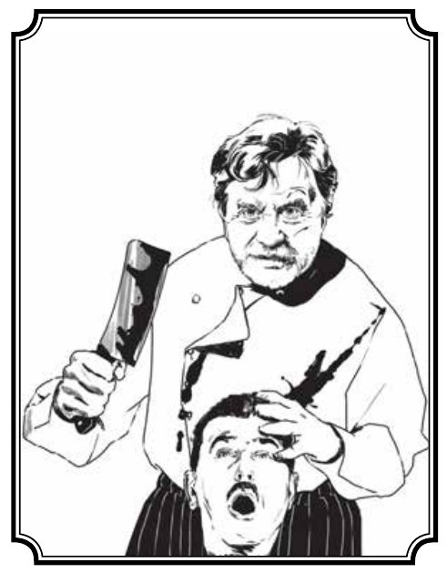

Ширли и Максин, преподобный Фицджеральд, Рэймонд Лоури или мистер Бингем).
- Из ресторана Элмера с криками выбегают посетители. Леонард Элмер гонится за ними с тесаком в одной руке и головой Феликса Таарамяэ в другой.

### Давление на Фреда Шенка

- Приставы, работающие на Коммерческий трастовый и сберегательный банк Стоуэлла, начинают выселять людей из домов. Людям велят уйти и забрать с собой всё, что смогут унести. Тем, кто отказывается, на входную дверь наклеивают плакат: «Выселены по распоряжению Коммерческого трастового и сберегательного банка Стоуэлла. Освободить в течение 12 часов, иначе — судебное преследование».
- Работников банка можно встретить вне работы, хотя они будут избегать всякого, у кого неприятности с банком. Если на них надавить, они могут запаниковать, убежать или закричать, что они не виноваты.
- Когда срок предупреждения истечёт, возвращаются вооружённые приставы и выселяют жильцов силой. Дело может дойти до стрельбы с обеих сторон, в которую втянутся и случайные прохожие.

## Город под названием Стоуэлл

Жизнь Стоуэлла держится на нескольких небольших предприятиях, в том числе консервном заводе и лесопилке. Важнейшие места отмечены на карте рядом; остальные (дома, конторы и т. п.) оставлены на воображение Хранителя.

**«Лучшие автомобили Эла».** Продаёт новейшие машины «Шевроле» и «Форд». Кроме того, в городе есть автомастерская и несколько автозаправок.

**Церкви.** Несколько церквей обслуживают по большей части христианское население городка. Последователи других религий собираются по домам. Среди церквей — Методистская епископальная церковь (настоятель — преподобный Фицджеральд), католическая церковь Святого Семейства и конгрегационалистская церковь.

**Дантисты.** Зубоврачебная помощь на любой кошелёк.

**Парикмахерская Джека.** Добротные мужские стрижки по моде 1920-х для любого мужчины.

**Ферма Дженсена.** На восточной окраине города, в конце грязной просёлочной дороги, стоит запущенная ферма Фредди Дженсена. Здесь держат в плену Глэдис Макдермотт. Машину Арнольда Макдермотта можно найти среди многих других, стоящих во дворе.

**Салон «Восхитительная Лори».** Салон красоты и дамская парикмахерская, балующая избранную клиентуру.

**Закусочная «Матушка Бейкер».** Закусочная на Мейн-стрит. С тех пор как миссис Бейкер посмотрела в телескоп, здесь стали подавать новые блюда. Сироп, которым она поливает вафли, поистине замечателен. А в бургерах есть что-то такое, что никто толком не может распознать, но на вкус это просто райское наслаждение. О «Матушке Бейкер» все говорят, и посетителей у неё хоть отбавляй. Может статься, игроки решат, что корень происходящего — здесь. Это не так.

**Полицейский участок Стоуэлла.** Обычно открыт в рабочие часы. В нём всего четыре камеры предварительного заключения, ведь обычно заключённых переводят в окружную тюрьму.

**Дом профессора Харта.** На западной окраине города стоит старый дом, где живут профессор и его кошки. См. «Дом профессора Харта» (с. 94).

**Магазины.** Пекарни, универсальные магазины, аптеки, кондитерские, закусочные и скобяные лавки.

**Площадка отдыха и золотой прииск.** На площадке отдыха стоят качели и карусели. За ними — скалистый выступ, вокруг которого недавно выросло несколько наспех сколоченных хижин. Под присмотром Клода Мэсси (см. с. 91) бригада рабов-Сломленных копает днём и ночью и недавно нашла золотую жилу.
