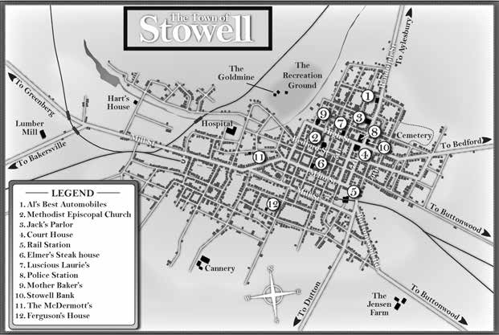

**Условные обозначения карты**

1. «Лучшие автомобили Эла»
2. Методистская епископальная церковь
3. Парикмахерская Джека
4. Здание суда
5. Железнодорожная станция
6. Стейк-хаус Элмера
7. Салон «Восхитительная Лори»
8. Полицейский участок
9. Закусочная «Матушка Бейкер»
10. Банк Стоуэлла
11. Дом Макдермоттов
12. Дом Фергюсонов

*Другие подписи на карте:* Золотой прииск, Площадка отдыха, Дом Харта, Больница, Лесопилка, Кладбище, Консервный завод, Ферма Дженсена; дороги — на Гринберг, на Бейкерсвилл, на Эйлсбери, на Бедфорд, на Баттонвуд, на Даттон.

**Коммерческий трастовый и сберегательный банк Стоуэлла.** Им руководит (прежде) благожелательный мистер Бингем, известный готовностью помогать мелким вкладчикам.

**Больница Стоуэлла.** В больнице есть стационар, здесь лечат самые разные недуги, но для узкоспециальной помощи и серьёзных операций может понадобиться более крупное заведение в соседнем городе.

## Горожане

В Стоуэлле три рода людей: те, кто посмотрел в телескоп и стал Сломленным; те, кто посмотрел и стал Благословенным; и те, кто вовсе не смотрел. Ниже перечислены все персонажи, связанные с предысториями сыщиков (с датой, когда они посмотрели в телескоп), а также некоторые другие горожане (для которых даты и другие подробности — по необходимости).

Характеристики главных персонажей Хранителя (ПХ) см. в «Приложении A. Персонажи».

### Благословенные

**Стэнли Александер**, помощник начальника полиции, Благословенный с 17 февраля. Зорко присматривает за городом. Прикрывается Мартином Кавано (одним из Сломленных), подсказывая ему, что говорить и как себя вести.

**Томас Бингем**, управляющий банком, Благословенный с 26 февраля. Мистер Бингем щедро давал ссуды, но теперь ужесточил финансы банка. Он нанял множество приставов, чтобы безжалостно возвращать собственность банка. Фред Шенк (готовый сыщик) — один из первых, кого выселяют.

*Прим. перев.: здесь в оригинале фамилия напечатана как «Schrenck»; на с. 93 — «Schenk»; верно — Шенк (Schenck).*

**Миссис Брэди**, учительница на пенсии, Благословенная с 21 февраля. Возможно, миссис Брэди учила тех сыщиков, кто ходил в местную начальную школу. Миссис Брэди полюбила набирающее силу новое чудо — радио — и часами собирала детекторные приёмники и разбирала подобные устройства. Её страсть к радио стала средоточием её возросшего мастерства, и она глубоко разобралась в электронике. Она собрала для старика Пирсона подслушивающее устройство для телефонных линий.

**Рэймонд Лоури**, отец Берта Лоури (готового сыщика), Благословенный с 24 февраля. Рэймонд работал в Коммерческом трастовом и сберегательном банке Стоуэлла. Теперь он всё время играет странную музыку у себя дома и в церкви преподобного Фицджеральда.

**Максин и Ширли Фергюсон**, племянницы Уэсли Фроста (готового сыщика), Благословенные с 26 февраля. Сёстры-близнецы, дочери Гленды и Дональда Фергюсонов. Обе теперь одержимы анатомией и ставят опыты на самых разных живых существах, в том числе на своём отце.
