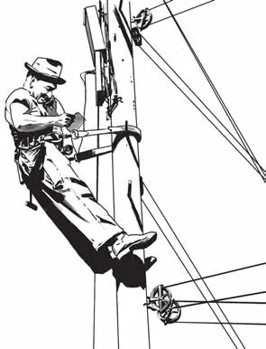

**Преподобный Фицджеральд**, влиятельный церковный пастырь, Благословенный с 16 февраля. Друг профессора Харта, Фицджеральд — пастор Методистской епископальной церкви.

**Профессор Мелвин Харт**, учёный профессор, Благословенный с 14 февраля. Профессор Харт создал телескоп, через который удалось вступить в контакт с Великим Разумом.

**Клод Мэсси**, геолог и старатель, Благословенный с 17 февраля. У Клода всегда был талант к геологии, а Великий Разум углубил его понимание этой науки. Бригада местных Сломленных под его началом разрывает каменистый грунт сразу за площадкой отдыха. Он нашёл там золотую жилу. Помимо денежной ценности, золото очень пригодится нескольким Благословенным в их опытах.

**Старик Пирсон**, проворный старожил, Благословенный с 20 февраля. Пирсон сидит высоко на телефонном столбе, слушает голоса (или музыку) в проводах, улыбается и машет сверху прохожим. Пирсон держал местный театр, а в детстве обожал лазать — именно этот навык и развился, когда он посмотрел в телескоп. Ему уже за семьдесят, и когда сыщики в последний раз его видели, он ходил с палкой. У него есть подслушивающее устройство, которое ему на скорую руку смастерила миссис Брэди: провода и наушники, которые каким-то образом подключаются к телефонным кабелям. Подслушивая телефонные разговоры, он, возможно, знает кое-какие слухи.

**Херман Ши**, мастер маскировки, Благословенный с 25 февраля. Тайная жизнь Хермана — переодевание в женское платье — вышла на первый план в его новой жизни мастера маскировки. Теперь он может принять облик любого мужчины или женщины в городе и делает это с огромным удовольствием. Если Херман выдаёт себя за горожанина, которого сыщик знает лишь шапочно, нужна чрезвычайная проверка **Внимания**, чтобы понять, что это не тот, за кого он себя выдаёт. Если он пытается выдать себя за кого-то, кого сыщик хорошо знает, для разоблачения маскировки достаточно успешной проверки **Внимания**.

**Феликс Таарамяэ**, новый управляющий стейк-хауса Элмера, Благословенный с 27 февраля. Прежде официант, Феликс теперь заправляет рестораном и стремится довести меню до совершенства, снабжая всех Благословенных чудесной едой.

**Брэд и Тодд**, дети-«умники», Благословенные с 26 февраля. Брэду и Тодду всего по десять лет, но их можно застать за оживлённым обсуждением физики. Уровень обсуждения очень высок: такие понятия, как «универсальная волновая функция», «случайный радиоактивный распад» и «квантовая декогеренция», употребляются походя и, по-видимому, с полным пониманием. Если сыщики попытаются присоединиться к разговору, их могут высмеять за невежество или за приверженность устаревшим взглядам на науку и мир. Если у вас, Хранителя, нет диплома физика, изобразить нужный уровень знаний может быть трудно; просто скажите игрокам, что вы тоже этого не понимаете, и вставьте несколько ключевых выражений из упомянутых выше. Если не считать глубоких познаний в физике, это самые обычные десятилетние мальчишки; им скоро наскучит общаться с сыщиками, и они отправятся в магазин Грегсона за газировкой.

### Сломленные

**Кеннет Маккарди**, обезумевший убийца, Сломленный с 22 февраля. Маккарди появляется во вступительной сцене (с. 86). Это обезумевший кровожадный мужчина средних лет, который до недавнего времени работал в универсальном магазине.

**Фредди Дженсен**, извращенец и главарь банды, Сломленный с 20 февраля. Дженсен — один из самых умных и коварных Сломленных. У него шайка из четырёх человек, которая делает для Благословенных грязную работу. Дженсен выполняет приказы Благословенных, потому что может выбирать себе Сломленных по вкусу, а он любит безмозглых, особенно хорошеньких. Его банда состоит из других Сломленных. Вместе они захватили небольшую ферму на окраине города. Он оказывает Благословенным услуги и получает за это щедрую награду. Дженсен — один из немногих Сломленных, кому позволено водить машину. Его ферма служит стоянкой для машин, которые больше не нужны другим рабам-Сломленным. Кроме того, у него там несколько Сломленных для собственной забавы, в том числе Глэдис Макдермотт. В его банду входят Родди Мэтьюз, Стэнли Макгарви и Роланд Бёрфорд.

**Роланд Бёрфорд**, член банды Дженсена, Сломленный с 21 февраля. Роланд — отчаявшийся подросток, который связался
