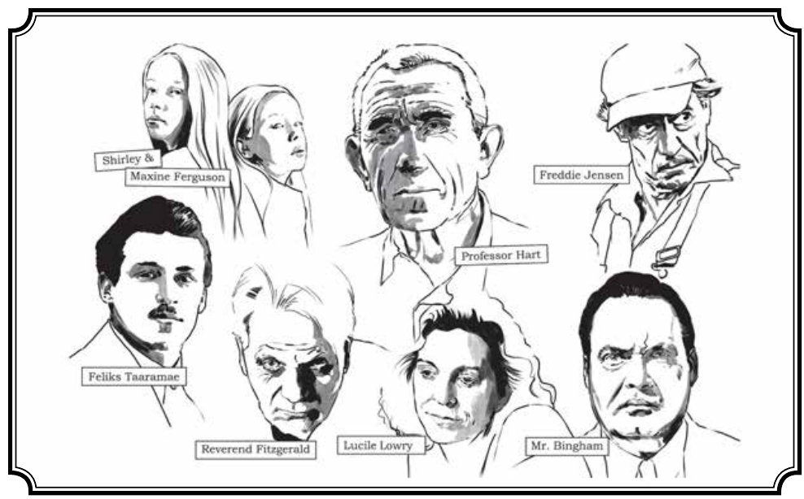

*Подписи на рисунке: Ширли и Максин Фергюсон, Профессор Харт, Фредди Дженсен, Феликс Таарамяэ, Преподобный Фицджеральд, Люсиль Лоури, Мистер Бингем.*

с дурной компанией. Он у банды на побегушках и мишень для их шуток.

**Родди Мэтьюз**, член банды Дженсена, Сломленный с 21 февраля. Ровесник сыщиков по школе, Родди из рабочей семьи с восточной окраины города. Его отец работал на лесопилке, пока десять лет назад не получил увечье. Родди водится с бандой Дженсена. С ним будет Макгарви, старый друг его отца.

**Стэнли Макгарви**, член банды Дженсена, Сломленный с 22 февраля. Стэнли — крепкий, грозный мужчина лет под пятьдесят. Он — сила за спиной Родди Мэтьюза и носит при себе пистолет.

**Мартин Кавано**, полиция, Сломленный с 17 февраля. Местному начальнику полиции Мартину Кавано указывает, что делать, его помощник-Благословенный Стэнли Александер, который не спускает с него глаз.

**Леонард Элмер**, хозяин стейк-хауса Элмера, Сломленный с 27 февраля. Теперь, низведённый до мытья посуды, Леонард ждёт своего часа, чтобы отомстить.

**Дональд Фергюсон**, зять Уэсли Фроста (готового сыщика), Сломленный с 26 февраля. На Дональде ставят опыты его дочери-близнецы, Ширли и Максин. Его жена, Гленда, бессильна ему помочь.

**Гленда Фергюсон**, сестра Уэсли Фроста (готового сыщика), Сломленная с 26 февраля. Гленда — домохозяйка; у неё дочери-близнецы, Ширли и Максин, и муж, Дональд. Теперь Гленда в услужении у своих дочерей.

**Арнольд Макдермотт**, любовник Бетти Консидайн (готового сыщика), Сломленный с 25 февраля. Теперь Арнольд — раб в стейк-хаусе Элмера, где он готовит зелёную фасоль и особый соус. Его держат в повиновении угрозами расправиться с женой.

**Глэдис Макдермотт**, жена любовника Бетти Консидайн (готового сыщика), Сломленная с 25 февраля. Глэдис — пленница на ферме Дженсена. Она служит горничной и делает всё прочее, чего хотят от неё Дженсен и его банда. Скорее всего, она попытается сбежать.

### Ещё не Благословенные и не Сломленные

Подробностей о других горожанах книга не даёт, чтобы Хранитель мог придумывать персонажей по мере надобности, в зависимости от действий сыщиков. Вот несколько возможных имён для таких горожан:

- **Мужчины:** Альфред Далхофф, Говард Финнерти, Стерлинг Гилби, Уэйн Хейтман, Ли Лакстон.
- **Женщины:** Клара Бишоп, Эстер Франц, Мейбл Хейген, Норма Ларсон, Минни Ланстрам.
