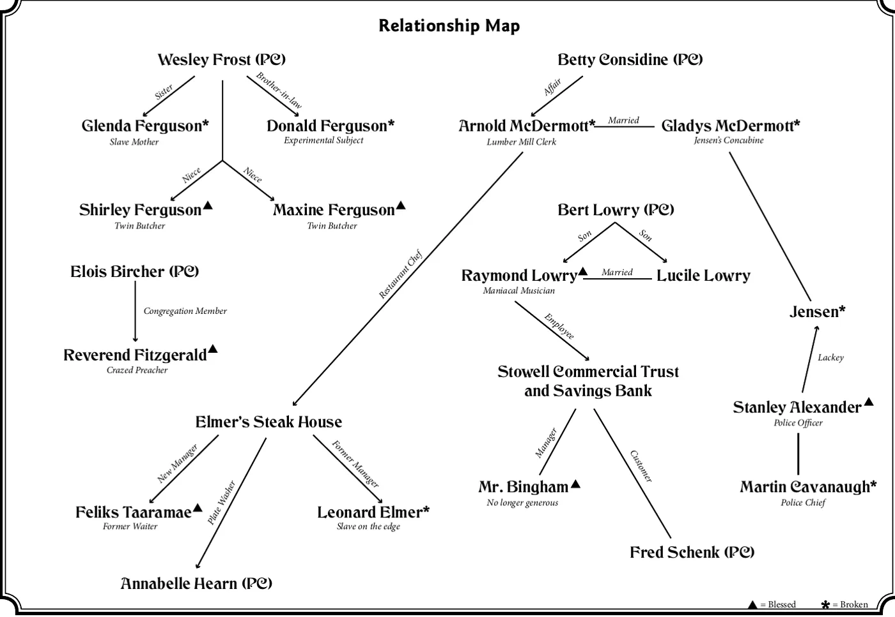

## Карта связей

*Перевод подписей схемы: ▲ — Благословенный; \* — Сломленный; (PC) — готовый сыщик. Под именами — краткие характеристики, на линиях — связи.*

- Уэсли Фрост (PC) — «сестра» → Гленда Фергюсон\* («мать-рабыня»)
- Уэсли Фрост (PC) — «зять» → Дональд Фергюсон\* («подопытный»)
- Уэсли Фрост (PC) — «племянница» → Ширли Фергюсон▲ и Максин Фергюсон▲ («близнецы-мясники»)
- Бетти Консидайн (PC) — «роман» → Арнольд Макдермотт\* («клерк лесопилки»)
- Арнольд Макдермотт\* — «женаты» — Глэдис Макдермотт\* («наложница Дженсена»); от Глэдис — линия к Дженсену\*
- Арнольд Макдермотт\* — «повар ресторана» → Стейк-хаус Элмера
- Берт Лоури (PC) — «сын» → Рэймонд Лоури▲ («безумный музыкант») и Люсиль Лоури; Рэймонд и Люсиль — «женаты»
- Рэймонд Лоури▲ — «служащий» → Коммерческий трастовый и сберегательный банк Стоуэлла
- Банк — «управляющий» → мистер Бингем▲ («больше не щедр»); банк — «клиент» → Фред Шенк (PC)
- Элойс Бирчер (PC) — «прихожанка» → преподобный Фицджеральд▲ («безумный проповедник»)
- Стейк-хаус Элмера — «новый управляющий» → Феликс Таарамяэ▲ («бывший официант»); «бывший управляющий» → Леонард Элмер\* («раб на грани»); «судомойка» → Аннабель Хёрн (PC)
- Стэнли Александер▲ («полицейский») — «подручный» → Дженсен\*; Стэнли Александер▲ — Мартин Кавано\* («начальник полиции»)

*Прим. перев.: на схеме фамилия Фреда Шенка напечатана как «Schenk».*
