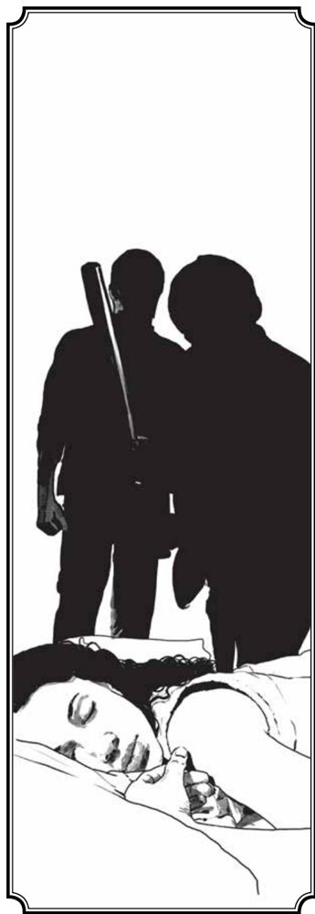

## Как вести день хоррора на выживание

Сожмите события дня до нескольких сцен. Сначала — первый натиск, когда Благословенные поднимаются и начинают нападать. Что будет дальше, зависит от игроков. Обычно они выбирают один из трёх путей: укрыться в надёжном месте, бежать из города или устроить бойню.

### Если сыщики уже уехали из города

Каждому игроку, у которого больше нет сыщика в городе — из-за гибели или бегства, — нужно дать одного из запасных персонажей (см. «Запасные персонажи», с. 100). Этих персонажей стоит выбирать из тех, кто уже встречался в игре, например близких друзей или родственников первоначальных сыщиков. Если в вашей игре заметную роль сыграл какой-то персонаж Хранителя — может быть, придуманный по ходу игры, — он тоже может оказаться хорошим кандидатом. По сути, спросите себя, чью судьбу из персонажей Хранителя вам больше всего хотелось бы увидеть разыгранной. Для запасных персонажей даны подборки характеристик и значений навыков. Можете изменить их под свои нужды. Помните: такие персонажи не обязательно должны быть так же подробно и полно проработаны, как обычный сыщик.

### Первый натиск

Определите, где находятся сыщики на рассвете, когда начинается первый натиск. Благословенные, скорее всего, рассеяны по всему городу, но многие из них могут собраться в доме профессора. Того, что Сломленные на рассвете падают без чувств, могут и не заметить: скорее всего, они спят в своих постелях — где многих и убьют во сне.

Если сыщики спят, их могут разбудить крики снаружи или ворвавшийся в спальню Благословенный. В этой сцене, скорее всего, будет бой, а может, и погоня.

Если сыщики разделены, пусть каждая подгруппа втайне (запиской) сообщит вам, куда собирается идти, если только они заранее не договорились о месте встречи. Это усиливает чувство одиночества.

Благословенные отрежут телефоны, так что связаться друг с другом этим путём не получится, как и позвать помощь извне.
