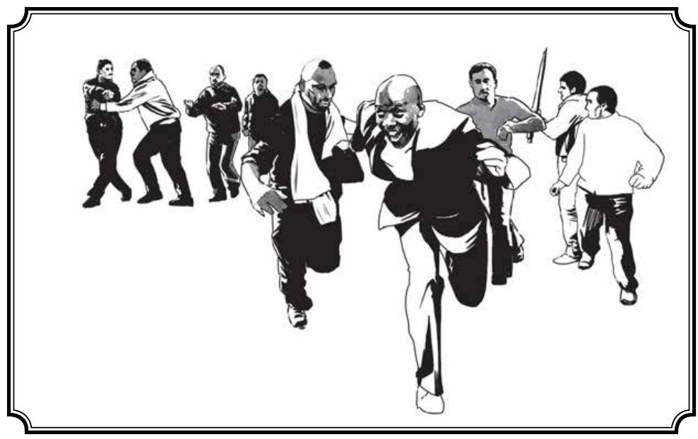

считать эти выстрелы касательными, ограничив урон 1d6.
- Чтобы сдержать орды, можно соорудить горящие заграждения. Чтобы перепрыгнуть через заграждение без урона, нужна успешная проверка **Прыжков**.
- На Стоуэлл обрушивается ливень, смывая на улицу грязь и мусор. Пройдите проверку **ЛВК**, чтобы устоять на ногах.

Вот некоторые препятствия и преграды для погонь на машинах:

- Поперёк дороги свалено дерево, чтобы горожане не сбежали. Чтобы столкнуть дерево с пути или оттащить его с дороги, понадобится большая машина (Комплекция 6+).
- Из-за ливня вести машину опасно. Пройдите проверку **Вождения автомобиля**, чтобы не занести в канаву и не врезаться в дерево.
- Благословенные собираются на дороге, притворяясь бегущими из города горожанами, и машут машине, чтобы их подвезли. Пройдите проверку **Вождения автомобиля**, чтобы не сбить их, — или сбейте их и получите урон от столкновения.
- Стэнли Александер (см. с. 90) мог выставить полицейский заслон. У заграждения 15 пунктов здоровья.
- Дорога к Стоуэллу узкая и извилистая, и на поворотах приходится много раз проходить проверку **Вождения автомобиля**.

## Заключение

Рекомендуемые награды Рассудка сыщикам, завершившим этот сценарий:

- Если связь с Великим Разумом прервана: +1d6 очков Рассудка.
- Тем, кто сбежал, обрекая горожан на страшную участь: потеря 1d6 очков Рассудка.
