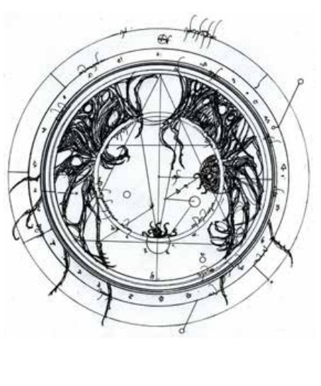

### Благословенные взрослые (образец)

Используйте этот образец как основу для любых встреченных Благословенных взрослых. Хранителю стоит при необходимости подогнать характеристики и навыки под конкретного человека. На каждого это подействовало по-своему, и каждый будет заниматься своими интересами. Дайте каждому профильный навык, в котором он блистает.

```stat
СИЛ 60    ВЫН 50    ТЕЛ 60    ЛВК 55    ИНТ 65
НАР 50    МОЩ 50    ОБР 65    Рассудок 40   ПЗ 11
БкУ: 0    Комплекция: 0   Скорость: 7    ПМ: 10

Ближний бой (драка)   25% (12/5), урон 1d3
Уклонение             25% (12/5)

Навыки: профильный навык 50% или выше (любой), Мифы Ктулху 6%, Убеждение 30%.
```

*Прим. перев.: так в оригинале — при СИЛ, равной ТЕЛ, по правилам Скорость 8 (7 подходит к возрасту 40–49); базовое Уклонение при ЛВК 55 — 27% (13/5).*

**Описание:** должны казаться странными — от очаровательной эксцентричности до злобы и жути.

**Черты:** склонны к минутам глубокой задумчивости.

**Зацепки для отыгрыша:**

- Стараются успокоить сыщиков и убедить их, что всё улаживается к лучшему. Тревожиться не о чем.
- Обсуждают свою область знаний и устраивают сыщикам экзамен по ней.

### Сломленные дети и взрослые (образец)

Можно использовать те же характеристики, что и для Благословенных детей и взрослых, но у них не будет навыка Мифов Ктулху, а побуждения у них будут приземлённее.



## Запасные персонажи

Если сыщики погибнут или сбегут из города до рассвета, когда восстанут Благословенные, здесь для игроков перечислены персонажи Хранителя. Они не обязательно должны быть так же подробны, как полноценные сыщики. Предложите игрокам дополнить персонажей по своему вкусу.

### Гленда Фергюсон

*29 лет*

Гленда — жена Дональда (скорее всего, уже погибшего), мать девочек-близнецов (Ширли и Максин, обе Благословенные) и сестра Уэсли Фроста (готового сыщика).

```stat
СИЛ 40    ВЫН 50    ТЕЛ 60    ЛВК 80    ИНТ 50
НАР 70    МОЩ 50    ОБР 60    Рассудок 40   ПЗ 11
БкУ: 0    Комплекция: 0   Скорость: 8    ПМ: 10

Ближний бой (драка)   25% (12/5), урон 1d3
Уклонение             40% (20/8)

Навыки: Искусство/ремесло (вышивка) 50%, Обаяние 70%, Первая помощь 60%, Слух 60%, Естествознание 50%, Психология 50%. Игрок может выбрать любые другие четыре навыка и поднять каждый на 20 процентных пунктов над базовым значением.
```

### Арнольд Макдермотт

*30 лет*

Арнольд — клерк на лесопилке. Он муж Глэдис Макдермотт, и у него роман с Бетти Консидайн (готовым сыщиком).

```stat
СИЛ 50    ВЫН 60    ТЕЛ 60    ЛВК 40    ИНТ 80
НАР 50    МОЩ 50    ОБР 70    Рассудок 40   ПЗ 12
БкУ: 0    Комплекция: 0   Скорость: 7    ПМ: 10

Ближний бой (драка)   25% (12/5), урон 1d3
Уклонение             20% (10/4)

Навыки: Бухгалтерское дело 60%, История 50%, Работа в библиотеке 70%, Стрельба (винтовка/дробовик) 50%, Метание 60%, Убеждение 50%. Игрок может выбрать любые другие четыре навыка и поднять каждый на 20 процентных пунктов над базовым значением.
```

### Глэдис Макдермотт

*28 лет*

Глэдис — жена Арнольда Макдермотта, пострадавшая от рук Дженсена.

```stat
СИЛ 60    ВЫН 50    ТЕЛ 60    ЛВК 50    ИНТ 50
НАР 70    МОЩ 80    ОБР 40    Рассудок 40   ПЗ 11
БкУ: 0    Комплекция: 0   Скорость: 8    ПМ: 16

Ближний бой (драка)   25% (12/5), урон 1d3
Уклонение             25% (12/5)
```
