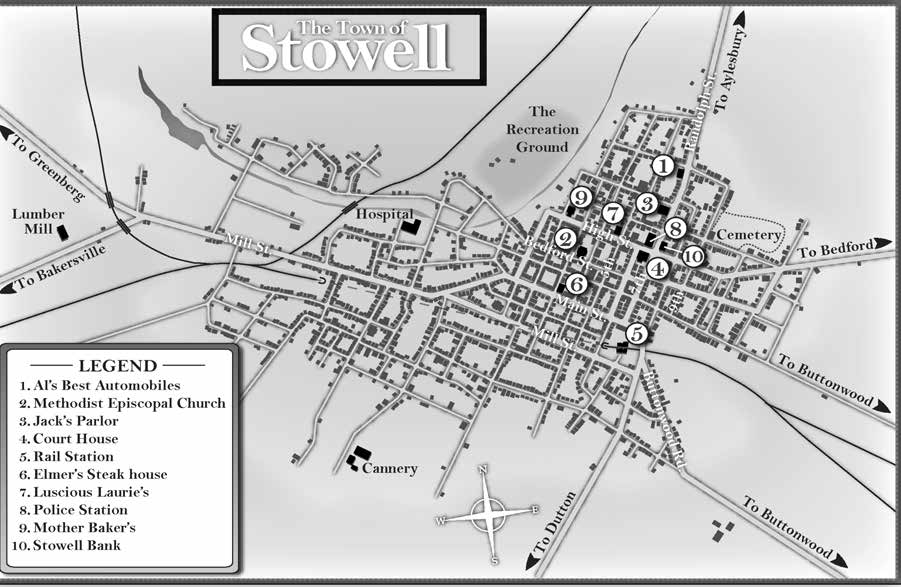

## Карта Стоуэлла для игроков

**Условные обозначения карты**

1. «Лучшие автомобили Эла»
2. Методистская епископальная церковь
3. Парикмахерская Джека
4. Здание суда
5. Железнодорожная станция
6. Стейк-хаус Элмера
7. Салон «Восхитительная Лори»
8. Полицейский участок
9. Закусочная «Матушка Бейкер»
10. Банк Стоуэлла

*Другие подписи на карте:* Город Стоуэлл, Площадка отдыха, Больница, Кладбище, Консервный завод, Лесопилка; улицы — Милл-стрит, Мейн-стрит, Хай-стрит, Бедфорд-стрит, Рэндолф-стрит, Баттонвуд-роуд, мелкие подписи 3-я, 4-я, 5-я (улицы); дороги — на Гринберг, на Бейкерсвилл, на Эйлсбери, на Бедфорд, на Баттонвуд, на Даттон.
