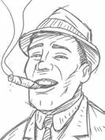

### Фред Шенк

*27 лет, парикмахер*



```stat
СИЛ 60    ВЫН 50    ТЕЛ 65    ЛВК 55    ИНТ 70
НАР 75    МОЩ 45    ОБР 40    Рассудок 45   ПЗ 11
БкУ: +1d4   Комплекция: 1   Скорость: 7    Удача: 65

Ближний бой (драка)   35% (17/7), урон 1d3 + 1d4
Уклонение             27% (13/5)

Навыки: Бухгалтерское дело 25%, Искусство/ремесло (парикмахерское дело) 50%, Обаяние 45%, Средства 20%, Маскировка 25%, Электрика 40%, Родной язык (английский) 40%, Взлом 31%, Ловкость рук 40%, Скрытность 50%, Метание 50%.
```

**Предыстория:**

- **Описание:** крупный и сильный. Видный малый, который к тому же любит хорошо одеваться. Ты щеголяешь шляпой и сигарой.
- **Идеология/убеждения:** под внешней оболочкой все люди одинаковы; ты их стрижёшь и с ними разговариваешь — тебе ли не знать.
- **Значимые люди:** мистер Бингем, управляющий местным банком, который дал тебе денег взаймы на покупку дома. И чаевые он всегда даёт щедрые.
- **Важные места:** местная церковь. Ты не слишком набожен, но любишь посидеть там в тишине и подумать.
- **Ценное имущество:** отцовская серебряная зажигалка для сигар.
- **Черты:** честолюбив. Однажды у тебя будет целая сеть парикмахерских.

Когда ты пришёл в Коммерческий трастовый и сберегательный банк Стоуэлла, тебе сказали, что твою ссуду отзывают. Денег у тебя нет, и дом заберут, оставив тебя без крова. Это несправедливо. Банком руководит мистер Бингем, известный своей добротой и поддержкой горожан. Может, банк перешёл в чужие руки?

*Прим. перев.: в раздатке (с. 86 и 102) сказано, что дом «отберут» (repossess), здесь — «заберут» (claim); по смыслу одно и то же.*

**Заметки игрока:** *(пустое поле для записей)*
