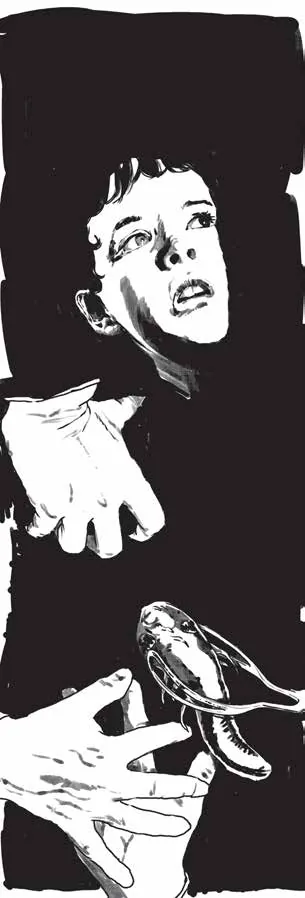

## Всё рушится

В ночь перед началом сценария члены Круга Мидаса пришли в лагерь бездомных, заткнули уши восковыми затычками и криком «куклы чревовещателя» — твари, которую они выхватили из другого измерения (см. с. 120), — усыпили жителей. Нэнси Карвер видела это и сошла с ума. Затем Круг похитил двух детей из лагеря, Билли Спитцера и Эстер Фрейн, и увёз их в «Проспект», чтобы не спеша выкачать из них силы.

Когда Седжвик включил устройство Хоукса, чтобы добыть свежих особей Вида 17, то, что когда-то было Астоном Хоуксом, воспользовалось утечкой поля устройства и снова вошло в нашу реальность. Не имея устойчивой физической формы, он вселился в ближайший предмет, достаточно большой, чтобы вместить его сущность, — в само здание «Проспекта». Бринк и Моллой в это время были в подвале и готовили пленников. Когда дом затрясся, застонал и начал меняться, они бежали, спасая свою жизнь, и бросили Эстер и Билли.

Билли сумел вырваться в суматохе, но Эстер уже заперли, и освободить её он не смог, поэтому сбежал из меняющегося дома один. В его брюшной полости всё ещё сидит особь Вида 17. Он ранен и наполовину обезумел от увиденного. Доберётся до Гувервиля он не скоро, а когда доберётся, будет говорить почти бессвязно и мучиться виной за то, что бросил Эстер.

Круг Мидаса пока отступил из «Проспекта», но после событий этой ночи у каждого из его членов свои планы, и некоторые из них могут столкнуть их с сыщиками. С каждым часом то, что было Астоном Хоуксом, всё прочнее овладевает строением «Проспекта».

## Круг Мидаса

Круг Мидаса возник в 1928 году, когда Седжвик понял, что ему нужны соратники, чтобы в полной мере пользоваться силами, которые давали устройство Хоукса и Вид 17. Он разыскал нескольких людей, которым, как ему казалось, можно доверять и у которых было нужное сочетание честолюбия и моральной гибкости. Поначалу это были только Роско Моллой и Каспер Бринк, но потом они приняли Алекса Россетти, поняв, что никто из них не годится для насилия.

Когда в сентябре 1929 года рухнул фондовый рынок, члены Круга Мидаса оказались среди тех немногих, кто на этом нажился. С тех пор, как бы плохо ни шли дела, они продолжают зарабатывать. Поглотив удачу и волю других людей, каждое деловое решение они принимают верно.

Члены Круга стараются держаться в тени, но то, что кучка людей, обыгравших судьбу, живёт в одном сравнительно небольшом городке, не осталось незамеченным. Об их поразительной способности делать деньги вопреки невзгодам написано немало газетных и журнальных статей.
