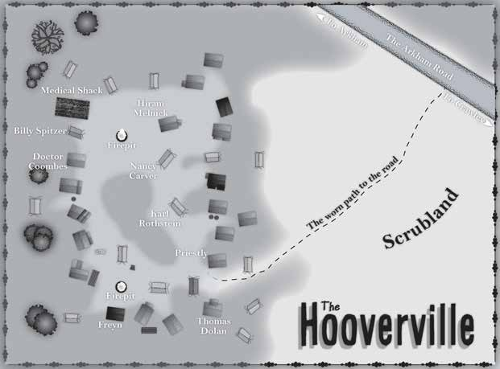

**Подписи на карте «Гувервиль»:** The Hooverville — Гувервиль; Medical Shack — медицинская лачуга; Hiram Melnick — Хайрам Мельник; Billy Spitzer — Билли Спитцер; Doctor Coombes — доктор Кумбс; Nancy Carver — Нэнси Карвер; Karl Rothstein — Карл Ротштейн; Priestly — Пристли; Freyn — Фрейны; Thomas Dolan — Томас Долан; Firepit — кострище (два); The worn path to the road — натоптанная тропа к дороге; Scrubland — пустырь; The Arkham Road — Аркхэмская дорога; To Arkham — на Аркхэм; To Crawley — на Кроули.

## Действующие лица

В этом разделе изложены предыстория и роль каждого из главных персонажей Хранителя этого сценария. Характеристики каждого — в «Приложении A. Персонажи».

Хранителю стоит хорошо знать отношения между персонажами Хранителя и готовыми сыщиками игроков: их взаимодействие важно. На с. 118 дана карта связей, на которой показаны связи между персонажами.

### Гарольд Пристли

Муж Агаты Пристли (готовый сыщик) и самая частая цель Круга Мидаса (отчего его угасание и ускорилось). Когда-то он был полным сил молодым человеком и восходящим талантом «Кроули экзаминер», но теперь из него высосали всё, и его разум и тело отказывают. После последнего выкачивания его плоть крошится, кости стали хрупкими, и он начинает разваливаться на куски. Одна из особей Вида 17 отложила в нём яйца, и они питаются им.

Работая в «Экзаминере», Гарольд расследовал дела Круга Мидаса и задавал не те вопросы. Седжвик и его сообщники выбрали его целью особо, чтобы уменьшить опасность разоблачения, и поэтому его здоровье сдаёт быстрее, чем у кого-либо в Гувервиле. Его судьба показывает сыщикам, что ждёт их самих и их близких.

Характеристик Гарольда не дано: он умрёт ещё до конца вступительной сцены.

**Внешность:** истощённая оболочка человека, почти не способная двигаться. Тонкие каштановые волосы выпадают клочьями, кожа потрескалась и шелушится. Глаза застыли широко распахнутыми от ужаса.

**Черты:** говорит прерывистым, страдальческим шёпотом.

**Зацепки для отыгрыша:**

- Просит сыщиков помочь, хотя помочь ему они ничем не могут.

### Билли Спитцер

Билли — дружелюбный, добродушный сирота, который принял жителей Гувервиля как свою новую семью.

Вместе с Эстер Фрейн Билли был похищен Кругом Мидаса для выкачивания в ночь перед началом сценария. Когда то, что когда-то было Хоуксом, начало проявляться, оно нарушило работу устройства Хоукса, и Билли сумел сбежать в суматохе, хотя освободить Эстер не смог.

В Билли всё ещё живёт одна из тварей Вида 17, и она высасывает его досуха. Если её не извлечь в течение восьми часов с того момента, как сыщики его найдут, он начнёт крошиться и умрёт так же, как Гарольд Пристли.
