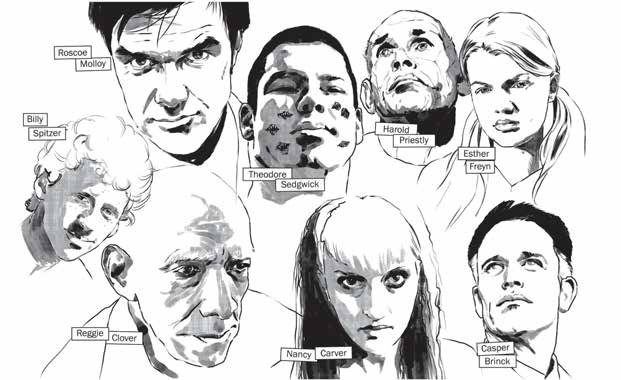

Из-за переохлаждения, мелких ран и твари внутри Билли то теряет сознание, то приходит в себя, а когда говорит — почти бессвязно.

**Внешность:** у Билли кудрявые рыжие волосы и ярко-зелёные глаза. Хотя у него уже первые признаки загадочной болезни, он кажется полным неиссякаемой энергии.

**Черты:** Билли — неисправимый оптимист и старается улыбаться, несмотря на явную боль.

**Зацепки для отыгрыша:**

- Умоляет сыщиков помочь Эстер.

### Эстер Фрейн

Дочь Морин Фрейн (готовый сыщик). Эстер приспособилась к жизни в Гувервиле лучше матери. Она застенчива по натуре, но дружба с Билли Спитцером и тяготы жизни в лагере вытащили её из скорлупы, и она старается помогать чем может.

Когда начинается сценарий, Эстер заперта в камере затопленного подвала «Проспекта». В неё проникли паразиты, и если их не удалить, она не проживёт больше нескольких дней. Из-за темноты и холода она не знает, насколько сильно заражена, — знает только, что ей нехорошо. Кроме того, Эстер в ужасе оттого, что её бросили в таком страшном месте, и боится утонуть в густой жиже, которая поднимается вокруг неё.

**Внешность:** хрупкая девочка с большими карими глазами и жидкими каштановыми волосами. Обычно носит своё единственное хорошее платье, рваное и всё в заплатах.

**Черты:** пережитое за последние несколько лет сильно ударило по Эстер; она замкнутая, мечтательная девочка, которая обычно молчит, пока к ней не обратятся.

**Зацепки для отыгрыша:**

- Сдавленным голосом зовёт маму и, когда она рядом, высказывает вслух страхи всех остальных.
- Паникует, когда выясняется, насколько сыщик заражён (изобразите, как пытаетесь выщипать паразитов из своей плоти).

### Нэнси Карвер

Нэнси Карвер работала секретарём у Хайрама Мельника (готовый сыщик), пока его юридическая контора не разорилась. Карвер — смышлёная молодая женщина, но по натуре глубоко неуверенная в себе, и она смирилась с новой жизнью в лагере.

С тех пор как в ночь перед вступительной сценой она увидела, как пришёл Круг Мидаса, и увидела, как они пустили в ход «куклу чревовещателя», разум Карвер надломился. Теперь она не хочет выходить из палатки, считая, что чудовища повсюду. Ей трудно понять, что она видела, а уж тем более рассказать об этом. Она может представить случившееся только так: люди без лиц заставили куклу петь, и эта песня — самое страшное, что она когда-либо слышала.
