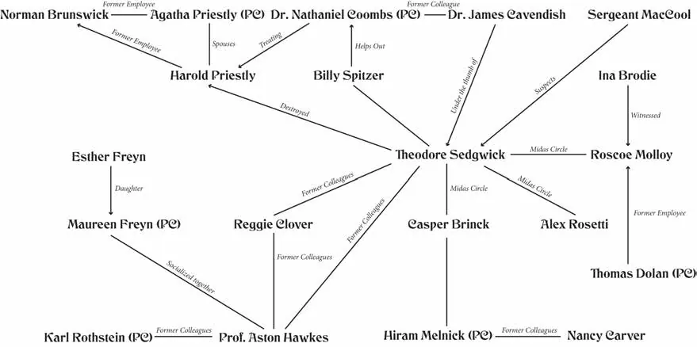

## Карта связей

**Связи на карте** (PC — готовый сыщик):

- Норман Брансуик — Агата Пристли (PC): бывшая сотрудница.
- Норман Брансуик — Гарольд Пристли: бывший сотрудник.
- Агата Пристли (PC) — Гарольд Пристли: супруги.
- Доктор Натаниэль Кумбс (PC) — Гарольд Пристли: лечит.
- Доктор Натаниэль Кумбс (PC) — доктор Джеймс Кавендиш: бывшие коллеги.
- Билли Спитцер — доктор Натаниэль Кумбс (PC): помогает.
- Билли Спитцер — Теодор Седжвик (связь без подписи).
- Теодор Седжвик — Гарольд Пристли: уничтожил.
- Доктор Джеймс Кавендиш — Теодор Седжвик: под пятой.
- Сержант Маккул — Теодор Седжвик: подозревает.
- Ида Броди — Роско Моллой: видела.
- Роско Моллой — Теодор Седжвик: Круг Мидаса.
- Каспер Бринк — Теодор Седжвик: Круг Мидаса.
- Алекс Россетти — Теодор Седжвик: Круг Мидаса.
- Томас Долан (PC) — Роско Моллой: бывший служащий.
- Эстер Фрейн — Морин Фрейн (PC): дочь.
- Морин Фрейн (PC) — проф. Астон Хоукс: бывали вместе в обществе.
- Реджи Кловер — Теодор Седжвик: бывшие коллеги.
- Реджи Кловер — проф. Астон Хоукс: бывшие коллеги.
- Проф. Астон Хоукс — Теодор Седжвик: бывшие коллеги.
- Карл Ротштейн (PC) — проф. Астон Хоукс: бывшие коллеги.
- Каспер Бринк — Хайрам Мельник (PC) (связь без подписи).
- Хайрам Мельник (PC) — Нэнси Карвер: бывшие коллеги.

*Прим. перев.: на схеме имена напечатаны как «Sergeant MacCool», «Ina Brodie», «Alex Rosetti» и «Dr. Nathaniel Coombs»; здесь — как в тексте сценария.*
