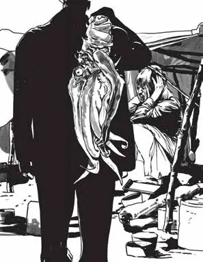

Любая попытка заставить Нэнси описать куклу обратит её с криками в бегство обратно в палатку.

Билли Спитцера в лагере нет. На его постели никто не спал. Эстер Фрейн тоже пропала: её постель смята — ночью она в ней спала, — но её туфли и пальто всё ещё в палатке, которую она делит с матерью. Её мать, Морин (готовый сыщик), ночью ничего не слышала и понятия не имеет, где Эстер.

Больше из лагеря никто не пропал, но есть следы переполоха. Грязь вокруг костра и палатки Фрейнов сильно истоптана и застыла на морозе. Проверка Чтения следов или Внимания покажет, что тут ходили четверо мужчин, и все — в дорогой, ухоженной обуви, какую никто в лагере не может себе позволить. Следы можно проследить на 200 м до Аркхэмской дороги, где видны отпечатки шин большого автомобиля, который выехал на дорогу и направился прочь от Кроули.

Следы ног и шин оставили члены Круга Мидаса, когда похищали Билли и Эстер, чтобы увезти их в «Проспект» на выкачивание. Как сказано в разделе «Предыстория», всё пошло не так, и Билли сбежал.

## Что теперь могут сделать сыщики?

На этом этапе перед сыщиками загадочная угроза и несколько улик. Единственно верного пути нет, поэтому Хранителю стоит быть готовым поддержать игроков в любом плане, который они выберут.

Доктор Кумбс может захотеть осмотреть Гарольда Пристли, хотя тот скоро умрёт.

Идти по следам шин будет трудно, но если кто-то из сыщиков доберётся до закусочной «Блю Стар», он может узнать, что ночью мимо проезжала машина Моллоя. Это может привести их к столкновению с Моллоем.

Если сыщики пойдут в Кроули и поговорят с полицией, они скоро обнаружат, что всем заправляет Седжвик и делает всё возможное, чтобы пресечь любое расследование исчезновений в Гувервиле. Похожие сведения можно добыть и в больнице.

В «Кроули экзаминер» никто не поможет, но там можно встретить Реджи Кловера и узнать о том, что он пережил по вине Теодора Седжвика.

Если сыщики откажутся от прямых действий и решат защищать лагерь, после наступления темноты их навестят члены Круга Мидаса. Это может дать сыщикам возможность узнать правду о безликих людях.

Если ничего другого не остаётся, сыщики могут встретить Билли Спитцера, который сбежал из «Проспекта» и знает, что Эстер Фрейн всё ещё там в плену. Это должно привести сыщиков прямиком в большую беду.

## Медицинская лачуга

Медицинская лачуга — самая большая постройка в Гувервиле. Она довольно прочная, хотя от холодного ветра защищает плохо. Доктор Кумбс (готовый сыщик) спасается от холода керосиновым обогревателем, но топливо так дорого, что включает он его только в самые морозные дни.

В лачуге две койки: одна пуста, на другой лежит Гарольд Пристли. В старом железном шкафу хранится бо́льшая часть медицинских припасов. Есть верстак с масляной лампой и спасённым со свалки микроскопом, с помощью которого доктор Кумбс изучает загадочную болезнь, опустошающую лагерь. Рядом с верстаком стоят старые ящики из-под яблок с записями и справочниками Кумбса.

Средства, которые удалось раздобыть доктору Кумбсу, скудны, но он делает с ними всё, что может. Припасы в лачуге в основном пожертвованы доктором Кавендишем из больницы Бентама. Круг Мидаса велел Кавендишу не позволять персоналу лечить людей из лагеря, чтобы те не задавали ненужных вопросов, но Кавендиш сумел тайком передать Кумбсу кое-какие припасы, чтобы унять чувство вины.
