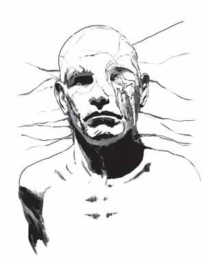

### Осмотр Гарольда Пристли

Если кто-нибудь попытается осмотреть Гарольда, обмыть его или напоить, он обнаружит, что плоть Гарольда стала настолько хрупкой и ломкой, что при первом же прикосновении оседает и обращается в пыль. Жидкость растворяет его плоть, так что если отереть ему лоб или дать глоток воды, последствия будут ужасны: куски лица Гарольда превратятся в кашу и потекут по его ещё живым останкам. Гарольд чувствует всё это и стонет от боли. Увидевший, как плоть Гарольда крошится или растворяется, проходит проверку Рассудка (потеря 1/1d6).

Гарольда не спасти. Успешная проверка Медицины облегчит его уход, но даже тогда он умрёт в течение часа — или гораздо скорее, если его переносить или грубо с ним обращаться. Дыхание его станет ещё тяжелее, с каждым выдохом будут вылетать облачка пыли, а потом оно прекратится совсем. В этот миг его тело растрескается и рассыплется.

Тщательный осмотр останков Гарольда обнаружит в его брюшной полости несколько маленьких кожистых мешочков, каждый размером с ноготь большого пальца. Внутри мешочков, в жёлтой жидкости, шевелятся крошечные тёмные тельца. Это яйцевые мешочки Вида 17; если их не уничтожить, в течение часа после извлечения из них вылупятся зародыши и попытаются уползти в безопасное место.

## Кроули

Кроули, штат Массачусетс, — городок средней величины с населением 15 000 человек, в 48 км к юго-западу от Аркхэма. До Великой депрессии Кроули процветал благодаря текстильной промышленности, но бо́льшая часть ткацких фабрик и заводов закрылась, и люди уезжают из города в поисках работы.

Сам Кроули приятен и ухожен, в нём есть почти всё, чего можно ждать от города такой величины. За городской чертой заброшенные фабрики превращают старые промышленные районы в уродливые пустоши. Исключение — дорога на Аркхэм: она идёт через зелёную сельскую местность с фермами, полями, перелесками и несколькими загородными домами и поместьями, среди которых «Проспект» и «Гринлиз».

### Полицейский участок

Единственный полицейский участок Кроули — отдельно стоящее двухэтажное здание из серого камня на Эшкрофт-стрит. Дежурный сержант, когда приходят сыщики, — Имон Маккул. Как и бо́льшая часть полицейского управления Кроули, Маккул выполняет указание начальника полиции: не расследовать никаких заявлений о преступлениях из Гувервиля, особенно об исчезновениях. Сержант Маккул не так жестокосерден, как можно подумать по его виду, и сочувственно выслушает сообщение о пропавших детях, но не станет записывать подробности и не позволит оформить исчезновение как преступление.

Трудная проверка Обаяния или Убеждения заставит Маккула признаться, что есть постоянный приказ никому из Гувервиля не помогать. Если надавить, он поделится подозрением, что это как-то связано с Теодором Седжвиком: тот регулярно навещает начальника, и сразу после этого, похоже, спускаются новые приказы.

Если сыщики устроят серьёзные неприятности, Маккул посоветует им бежать: он не может поручиться за их безопасность, если их арестуют. Маккул подозревает, что кое-кто из его коллег устроил так, что люди, задававшие не те вопросы, исчезли навсегда.

### Больница Бентама

Больница Бентама стоит на Таннер-стрит, в глубине собственного небольшого ухоженного участка. Здание выстроено из бурого кирпича, а арочный главный вход обрамляют колонны из серого камня.

Если сыщики придут в больницу с расспросами, Дорис Кейн, дежурная медсестра в приёмном покое, будет тянуть время и позовёт санитаров, чтобы те выставили сыщиков с территории. У Кейн есть указания насчёт бродяг, и истории, которые могут рассказать сыщики, мало её трогают.

Если кто-то из сыщиков тайком проберётся в больницу, чтобы увидеться с директором, доктором Кавендишем, или встретит его вне работы, тот будет сочувствовать, но ничем не поможет.
