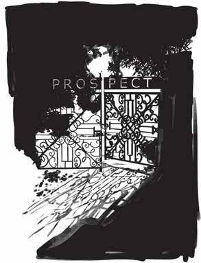

Ида, которая давно страдает бессонницей, вчера допоздна засиделась, сводя счета. Сразу после двух часов ночи она заметила, как мимо закусочной проехал чёрный «Кадиллак Шестнадцать» Роско Моллоя, направляясь прочь из Кроули. Тогда она не придала этому значения, но случай засел у неё в памяти: машина приметная, а ехать в такой поздний час, да ещё прочь из города, было странно. Было слишком темно, чтобы как следует разглядеть пассажиров, но машина, похоже, была набита битком.

## «Проспект»

«Проспект» был родовым домом семьи Хоуксов — загородная усадьба, построенная в конце XVIII века. Хоукс был последним в роду, так и не женился и не оставил наследников. После его исчезновения поместье купил Теодор Седжвик, и «Проспект» пустует, если не считать визитов Круга Мидаса. Он заброшен и приходит в запустение, но Круг не решается нанять кого-либо для ухода за ним, чтобы не раскрыть свою тайну.

Железные ворота заржавели, но на них новая цепь и висячий замок. Замок можно тихо открыть проверкой Взлома или просто сбить. Над воротами ржавая кованая вывеска с надписью «Prospect». Гравийная дорожка к главному зданию густо заросла сорняками, но самые крупные из них срезаны настолько, чтобы к дому могли подъехать автомобили.

В палой листве на дорожке видны следы шин, и проверка ИНТ подтвердит, что они совпадают со следами у Аркхэмской дороги рядом с Гувервилем.

Территорию окружает каменная стена высотой 3 м. Чтобы обойти её по периметру, здоровому человеку понадобится не меньше пятнадцати минут. Через стену можно безопасно перелезть, пройдя проверку Лазания; если людей двое или больше, они могут помогать друг другу перебраться, и это даёт бонусную кость.

### Территория

Территория занимает около 12 га; здесь летний домик, небольшое озеро, несколько обрушившихся теплиц, хозяйственные постройки и фруктовый сад — всё это постепенно отвоёвывает природа.

Лужайки одичали и заросли сорняками и молодыми деревцами, такими высокими, что за ними ничего не видно идущему сквозь них, хотя с приближением зимы заросли редеют. Кроме гравийной дорожки, расчищено ещё несколько тропинок, и между главным домом и хозяйственными постройками можно ходить, не прорубая себе путь сквозь подлесок. И всё же растения довольно часто задевают кожу сыщика, идущего по одной из этих узких тропинок, и становится ясно, что они покрыты слизью и липкими выделениями. Вокруг слышен шелест листвы, и время от времени видны маленькие серые или белые слизнеподобные твари, ползущие по земле или по стеблю растения.

Из-за нарушения сдерживания (см. «Устройство Хоукса», с. 127) часть тварей, призванных устройством, вырвалась и бродит по территории. Они питаются всякой живностью, которой хватит неосторожности забрести на территорию, или друг другом. Тут и там на территории лежат иссохшие трупы оленей и кроликов — одни наполовину растворены дождём и росой, другие готовы рассыпаться в прах от прикосновения.

Из густого подлеска сбоку от тропинки, что ведёт от главного дома к мастерской, доносится звук. Похоже, что всхлипывает мужчина, изредка задыхаясь и бормоча «помогите» — почти как скулёж. Это Джонни Рис, бродяга, который сегодня утром пробрался на территорию в поисках крова и плохо лежащих ценностей. Рис стал добычей паразитов, и от него остались лишь оболочка и последние проблески разума. Его плоть повсюду вздувается и извивается, а всё тело подёргивается от новой жизни, растущей внутри. Пока сыщики его осматривают, жирный бледный пиявкообразный паразит выползает через глазницу, почти не сдвинув глазное яблоко, спускается по лицу и заползает обратно в ноздрю. Увидевший это и общее состояние Риса проходит проверку Рассудка (потеря 1/1d6).

Спасти Риса нельзя, и всякий, кто задержится рядом с ним, рискует заразиться паразитами (см. «Паразиты», с. 120).
