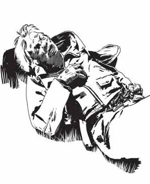

### Генераторные сараи

Сбоку от главного здания, за приземистой каменной мастерской, стоят два больших деревянных сарая. В каждом по два дизельных генератора, которые когда-то поставил Хоукс, чтобы питать своё устройство в мастерской. Роско Моллой поддерживает генераторы в исправности, а ещё протянул провода в главный дом, чтобы освещать его для дел Круга; если запустить генераторы, всё это освещение загорится, хотя свет в подвалах замкнуло капающей жидкостью.

Кроме генераторов, в сараях есть фонари, лампадное масло, ржавый садовый инвентарь, инструменты для обслуживания генераторов и пять больших бочек дизельного топлива.

### Мастерская

Бывшая мастерская Хоукса, которой теперь распоряжается Круг Мидаса, занимает самую большую из хозяйственных построек. Это квадратное каменное сооружение, со стенами длиной 7 м и высотой 3 м, явно современной постройки. Окон нет, и попасть внутрь можно только через тяжёлую чёрную железную дверь, запертую снаружи на висячий замок (его можно сбить или тихо вскрыть проверкой Взлома). Под одной из стен проходят два толстых электрических кабеля, тянущихся к генераторным сараям (проверка Внимания, чтобы заметить кабели, находясь среди хозяйственных построек).

Внутри мастерской темно. На потолке и стенах есть электрические лампы, но, пока не работает генератор, они не горят. Стену, в которой дверь, окружают электрические щиты, кабели и рубильники. Часть кабелей уходит по трубам к огромному железному кругу, вделанному в каменный пол. Круг искривлён, и на нём вырезаны странные узоры. Пол сильно запятнан, и в воздухе стоит смрад рвоты, нашатыря и острых пряностей. Электрическое оборудование и круг в полу и составляют устройство Хоукса, с помощью которого Круг Мидаса пробивал дыру в иное измерение и являл живущих там тварей.

> ### Как описывать «Проспект»
>
> После произошедших с ним перемен «Проспект» стал опасным, пугающим местом. Скорее всего, к тому времени, как сыщики туда доберутся, будет уже под вечер, и в диких зарослях будет темно. Со всех сторон будут слышны звуки движения, некоторые — пугающе влажные. Подлесок отвратительно скользкий и липкий, и всякий, кто в темноте заденет растения или сунет руку в тёмное место, нащупает мясистые извивающиеся комки. Здесь странные запахи — одни сладкие, почти аппетитные, другие едкие или тошнотворные, — и мало какие из них родом с этой земли.
>
> Не прекращайте описывать ощущения, пока сыщики исследуют территорию, и придумывайте на ходу. «Проспект» никогда не должен казаться безопасным местом.

> ### Горящая солярка
>
> Многие сыщики «Зова Ктулху» видят в огне решение всех жизненных проблем. Если сыщики решат поджечь «Проспект» соляркой из сараев, нужно помнить о нескольких вещах.
>
> Дизельное топливо зажечь гораздо труднее, чем бензин. Чтобы поджечь жидкую солярку (то есть не в виде взвеси), нужно долго держать её в пламени, и возгорание будет нарастающим сильным горением, а не взрывом, как у бензина. Чтобы разжечь огонь соляркой, понадобится 1d10 раундов — при условии постоянного воздействия на неё сильного пламени (горящей ткани и т. п.); если бросить спичку в лужу солярки, спичка просто погаснет.
>
> Если Эстер Фрейн всё ещё в плену в доме, сожжение «Проспекта» её убьёт.
