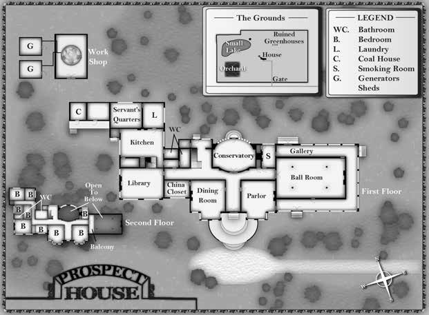

**Подписи на плане «Prospect House» (усадьба «Проспект»):** Work Shop — мастерская; Servant’s Quarters — людская; Kitchen — кухня; Conservatory — оранжерея; Gallery — галерея; Ball Room — бальный зал; Library — библиотека; China Closet — посудная; Dining Room — столовая; Parlor — гостиная; First Floor — первый этаж; Second Floor — второй этаж; Open To Below — проём на первый этаж; Balcony — балкон. Врезка «The Grounds» (территория): Small Lake — небольшое озеро; Ruined Greenhouses — разрушенные теплицы; House — дом; Orchard — сад; Gate — ворота.

**Условные обозначения (Legend):** WC — уборная; B — спальня; L — прачечная; C — угольная; S — курительная; G — генераторные сараи.

Вдоль двух стен тянутся деревянные верстаки, заваленные странным набором предметов: толстые кожаные фартуки и краги; сварочные маски; блестящие металлические щипцы длиной больше метра; сети из толстой бечёвки; набор ножей — от кинжалов до мачете; деревянный ящик с тридцатью восковыми затычками для ушей; и полдюжины круглых металлических банок (для перевозки особей) высотой 60 см и диаметром 20 см, из полированного алюминия, с плотно завинчивающимися крышками. Всё это снаряжение нужно, чтобы ловить особей Вида 17, когда они проплывают внутри круга устройства Хоукса, и отбиваться от других хищников, которых может привлечь разлом. Все металлы в мелких предметах — нежелезные, чтобы их не затянуло в разлом, пока устройство работает.

К задней стене привинчен стеклянный бак высотой около 2 м на ржавых железных опорах, с железной крышкой на висячем замке. По стеклу стекают струйки конденсата. Бак полон чего-то похожего на мутную воду, и внутри видно, как движутся какие-то формы. Здесь Круг Мидаса держит пойманных тварей про запас. В баке плавают три особи Вида 17. Там же плавает и «кукла чревовещателя», брошенная Кругом Мидаса, когда тот в панике бежал из «Проспекта» прошлой ночью.

### Устройство Хоукса

Устройство Хоукса работает иначе, чем резонатор Тиллингаста. Резонатор стимулировал шишковидную железу, позволяя людям воспринимать накладывающиеся друг на друга измерения, а устройство Хоукса схлопывает все доступные измерения в ограниченном пространстве. Это значит, что способность существ из иных измерений взаимодействовать с нашим — и наоборот — не ограничена человеческим восприятием. Поэтому оно гораздо опаснее: сдерживание — серьёзная проблема. При каждом включении устройство немного теряет в сдерживании, и мелкие сущности, когда устройство выключают, оказываются заперты в нашем измерении. Это те самые твари, что кишат на территории.

Включить устройство просто — достаточно подать на него электричество. Нужна мощность обеих пар генераторов, а рубильники на стене мастерской должны быть переведены во включённое положение. После этого устройству нужно тридцать секунд, чтобы набрать мощность, необходимую для открытия разлома.

Работая, устройство создаёт сильное электромагнитное поле, которое притягивает железо и заставляет волосы вставать дыбом. Оно издаёт инфразвуковой гул, от которого едва не слабеет кишечник и который вызывает глубокое чувство страха и неправильности. Затем пространство внутри искажается, как сквозь дрожащее марево, и сочится болезненным жёлтым светом. Затем являются твари. Увидевший это проходит проверку Рассудка (потеря 1/1d6).
