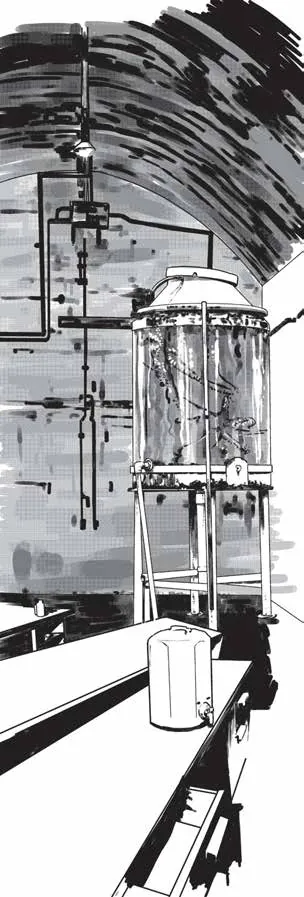

Если разрушить устройство, пока оно работает, оно полностью утратит сдерживание и оставит между двумя мирами открытую рану, через которую обитатели каждого из них смогут проходить в другой. Чтобы это исправить, придётся починить устройство (проверка двух навыков — Науки (физика) и Электрики), а затем безопасно закрыть врата; всё это время твари с той стороны будут проявлять к сыщикам живейший интерес.

Чтобы понять устройство настолько, чтобы переделать его или воспроизвести, нужна трудная проверка двух навыков — Науки (физика) и Электрики, — а также несколько часов на изучение самого устройства.

### За разломом

Если сыщик переступит железное кольцо, он окажется в совершенно чуждом краю. Органы чувств человека не способны осмыслить эту непрерывно меняющуюся среду, и она сбивает с толку полностью. Очертания причудливых форм жизни, смещающиеся измерения и искажённые виды нашей реальности ошеломляют, и мозг никак не может во всём этом разобраться.

Мир, который воспринимает сыщик, в каком-то смысле всё ещё наш, но увиденный глазами существ, живущих не в фазе с ним, за пределами нашего восприятия. Переживший это проходит проверку Рассудка (потеря 1d3/1d20).

Если сыщик пытается выбраться, игрок проходит проверку МОЩ, чтобы сыщик нашёл дорогу обратно через кольцо и не заблудился глубже в ином мире. Если это удалось, нужно ещё пройти проверку Удачи, чтобы не вернуться изрешечённым паразитами (см. «Паразиты», с. 120).

Если устройство Хоукса выключат, пока кто-то находится внутри кольца, этот человек пропадёт навсегда.

> ### Твари
>
> По ту сторону обитает великое множество тварей самых разных форм. Большинство похожи на глубоководных созданий, плывущих по воздуху, — бесформенных, щупальцевых, светящихся. Одни меньше кулака, другие так огромны, что в поле устройства проявляются лишь их части. Через пять минут поле заполнит огромный нечеловеческий глаз, глядящий наружу с невообразимым голодом; увидевший его проходит проверку Рассудка (потеря 1/1d10).
