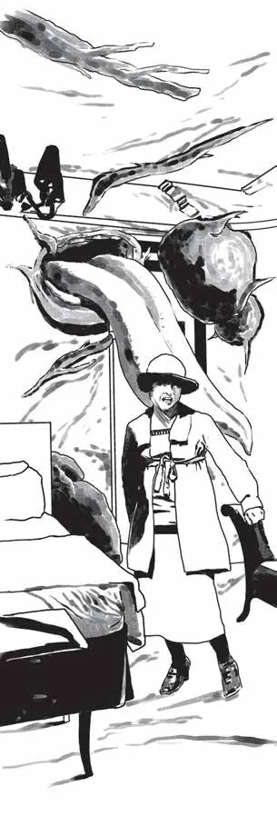

Каждая поверхность пульсирует. Увидевший это проходит проверку Рассудка (потеря 1/1d6).

Если сыщики попытаются заговорить с Хоуксом — знают они, что это он, или нет, — его голос раздастся из спальни хозяина. Это низкий, придыхающий гул, от которого содрогается весь дом; говорит он медленно и запинаясь. Хоукс совершенно безумен, и речь его будет обрывочной и бессвязной.

Когда Хоукс говорит, то, что поначалу кажется трещиной или разрывом в стене, раскрывается, выдувая струю липкого воздуха и брызги жидкости. За разрывом видна мокрая плоть, с которой стекают соки, и первые зазубренные белые выросты — будущие новые зубы Хоукса.

Если сыщик окажется настолько глуп, что разозлит Хоукса в этой комнате, тот схватит его языком, втянет в рот и проглотит (см. «Дом, который был Хоуксом», с. 120–121). После этого жертва окажется в столовой, готовая к перевариванию.

Здесь же Хоукс наиболее уязвим. Его мозг находится над потолком, и его можно уничтожить, убив тем самым Хоукса. Подробности — опять же в разделе «Дом, который был Хоуксом» на с. 120–121.

### Кухни

Анфилада комнат, в которую входят кухни, кладовая и комнаты прислуги, — в процессе перехода. Стены стали почти целиком органическими, покрытыми пульсирующей красной плотью, сквозь которую местами проглядывают пятна запачканной штукатурки и обоев. Дверные косяки тоже стали органическими и подёргиваются, как сфинктеры. Если сыщик впервые видит перемены, происходящие в «Проспекте», он проходит проверку Рассудка (потеря 0/1d4).

Полы, застеленные линолеумом или каменные, скользкие от выделений. Тому, кто бежит через эти комнаты, нужна проверка ЛВК, иначе он упадёт и перемажется зловонными жидкостями.

### Подвалы

Лестница в подвалы — за дверью в кухне. Выделения и стоки растущего Хоукса затопили подвал и замкнули электропроводку, поэтому лестница уходит в полную тьму. Вонь желчи, испражнений и гнили невыносима, и всякий спускающийся сыщик проходит проверку ВЫН, иначе его неудержимо рвёт.

Ступени скользкие от тёмной жидкости, спускаться по ним нужно осторожно. Сыщик, спускающийся неосторожно, проходит трудную проверку ЛВК, иначе скатится вниз, получит 1d3 урона и плюхнется в мерзкую лужу внизу. Ему также нужна проверка Удачи, чтобы не выронить в жидкость то, что он нёс, включая источники света.
