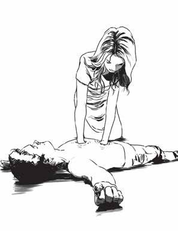

### Седжвик, Бринк и Россетти возвращаются в Гувервиль

После того как прошлой ночью их планы сорвались, остальные члены Круга Мидаса хотели бы на время затаиться, но Седжвик и слышать об этом не хочет. Он знает, что изменения его тела ускоряются, когда он остаётся без «кормёжки», а входить в «Проспект», чтобы выкачать Эстер, рисковать не хочет, поэтому настоял, чтобы остальные члены Круга пошли с ним в новый набег на Гувервиль.

Остальным это не по душе — особенно потому, что «кукла чревовещателя» осталась в «Проспекте», хотя, убегая, они всё же догадались прихватить две банки с особями Вида 17. Значит, чтобы похитить новых жертв, им придётся полагаться на скрытность или на силу. Моллой наотрез отказался в этом участвовать: у него свой тайный план вернуться в «Проспект».

Трое других членов Круга возвращаются в лагерь в час ночи, полагая, что к этому времени все уже спят. Они снова оставляют машину на большой дороге, в 200 м от края лагеря, и подбираются как можно тише. Поскольку их трое, а иней на земле время от времени хрустит, сыщики, которые прислушиваются, получают бонусную кость на проверку Слуха; проверка Внимания — как обычно. Члены Круга не особенно следили, кто где спит, и направятся к двум ближайшим палаткам, чтобы похитить тех, кто в них.

Эти палатки принадлежат Нэнси Карвер и Морин Фрейн (готовый сыщик). Нэнси, и так взвинченная после пережитого прошлой ночью, не спит и начинает кричать, как только кто-то начинает отворачивать полог её палатки. Этого шума с лихвой хватит, чтобы привлечь внимание остальных жителей.

Оказавшись под угрозой разоблачения, члены Круга попытаются бежать, а если путь отрезан — прорываться с боем. Ведите это как погоню или как бой, смотря по обстоятельствам. Бринк не хочет никого убивать; увидев, что кого-то с любой стороны подстрелили, он бросит оружие и попытается сбежать.

### Моллой едет в «Проспект»

Пока остальные члены Круга Мидаса заняты в Гувервиле, Моллой воспользуется случаем, чтобы вернуться в «Проспект». У него две цели: увезти как можно больше особей Вида 17 и в последний раз попытаться разобраться, как работает устройство Хоукса. Моллою надоел Круг Мидаса, особенно после ужасов прошлой ночи, и он хочет начать своё дело в другом городе.

Если заметны признаки чужаков — например, сбит замок на главных воротах, включены свет или генератор, — Моллой будет настороже и держать револьвер наготове. Он готов защищаться и не хочет делиться тем, за чем приехал. Если признаков чужаков нет, он направится в мастерскую и включит устройство Хоукса.

Если сыщики успокоят Моллоя или обезоружат его, а затем поговорят с ним, он охотно пойдёт с ними на сделку, особенно если кто-то из них понимает устройство Хоукса лучше него. Моллой с готовностью предаст других членов Круга любым способом, какой попросят сыщики, и охотно объяснит, как можно использовать Вид 17 и «куклу чревовещателя».

## Как всё завершить

Развязка почти целиком зависит от действий сыщиков. Как Хранителю, вам стоит найти подходяще драматичный момент, чтобы закончить игру, даже если какие-то сюжетные нити останутся оборванными.

Вполне возможно, что все сыщики сойдут с ума или погибнут в «Проспекте» — тогда найдите подобающе мрачный момент, чтобы описать их последнюю участь. Это касается и сыщиков, заражённых паразитами, хотя их смерть займёт больше времени, если они не найдут способа избавиться от паразитов.

Если сыщики одолеют Круг Мидаса, завладеют устройством Хоукса или особями Вида 17, выясните, как далеко сыщики готовы зайти с этой новой силой. Уничтожат ли они её, используют ли, чтобы исправить зло, или сами станут новым Кругом Мидаса?
