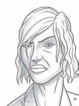

## Морин Фрейн, 34 года, бывшая светская дама



```stat
СИЛ 50    ВЫН 50    ТЕЛ 50    ЛВК 60    ИНТ 80
НАР 70    МОЩ 40    ОБР 60    Рассудок 40   ПЗ 10
БкУ: 0    Комплекция: 0    Скорость: 8    Удача: 20
ПМ: 8

Револьвер .38         60% (30/12), урон 1d10, дальность 15 м, атак в раунд 1 (3),
                      патронов 5, осечка 100
Ближний бой (драка)   25% (12/5), урон 1d3 + БкУ
Уклонение             30% (15/6)

Навыки: Искусство/ремесло (этикет) 60%, Обаяние 70%, Средства 1%, Вождение автомобиля 50%, Стрельба (пистолет) 60%, Первая помощь 50%, Иностранный язык (французский) 40%, Родной язык (английский) 60%, Слух 40%, Естествознание 40%, Верховая езда 50%, Внимание 50%, Скрытность 40%, Выживание (дикая местность) 40%, Плавание 40%, Чтение следов 50%.
```

### Биография

- **Внешность:** классическая красавица, но красоту портят худоба и шелушащаяся кожа. Одежда истрёпана, но элегантна.
- **Идеалы и принципы:** отошедшая от церкви англиканка, в которой ещё теплятся пошатнувшиеся остатки веры.
- **Значимые люди:** ваша двенадцатилетняя дочь Эстер. Только она и держит вас на плаву, и она — ваша единственная связь с тем, кем вы были.
- **Важные места:** бальный зал в «Проспекте», старом поместье Хоуксов, где вы впервые танцевали с вашим покойным мужем Чарльзом.
- **Ценное имущество:** револьвер .38, которым Чарльз покончил со всем. Он напоминает вам, что вы выбрали жить.
- **Черты:** пьёте чуть больше, чем вам полезно, когда удаётся раздобыть спиртное.

Вы — доказательство того, что даже старые деньги не уберегли от бед, последовавших за «чёрным вторником». Когда рухнул фондовый рынок, вы думали, что вы и ваша семья в безопасности. Потом ваш муж Чарльз застрелился, оставив вам непостижимые долги, и вы поняли, что в жизни больше ничто и никогда не будет надёжным.

Следующий год прошёл как в тумане — юристы, бухгалтеры, болезнь, и облегчение приносило только беспробудное пьянство. Друзья перестали звать вас на вечера, а потом перестали и перезванивать. Юристы забрали дом и драгоценности, и никого не оказалось рядом, чтобы подхватить вас, когда вы упали.

Теперь вы живёте примерно в 8 км от прежнего дома с его мраморными полами и декоративными садами. Ваш новый дом — деревянная лачуга, сколоченная из хлама, и вы живёте среди потерянных и обездоленных. Нетрудно понять, почему Чарльз вложил револьвер себе в рот, но вы сильнее, чем он когда-либо был. Ваша дочь Эстер зависит от вас и вашей силы, и вы не можете её бросить, как бы плохо ни шли дела. Вы найдёте способ вернуть то, что у вас когда-то было, чего бы это ни стоило.

**Заметки игрока:** ____________________
