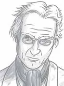

## Карл Ротштейн, 48 лет, бывший профессор физики



```stat
СИЛ 50    ВЫН 40    ТЕЛ 60    ЛВК 50    ИНТ 70
НАР 50    МОЩ 40    ОБР 80    Рассудок 40   ПЗ 7
БкУ: 0    Комплекция: 0    Скорость: 6    Удача: 20
ПМ: 8

Ближний бой (драка)   25% (12/5), урон 1d3 + БкУ
Уклонение             25% (12/5)

Навыки: Средства 1%, Вождение автомобиля 40%, Электрика 60%, Первая помощь 40%, Иностранный язык (английский) 50%, Родной язык (немецкий) 80%, Юриспруденция 40%, Работа в библиотеке 50%, Слух 40%, Механика 50%, Управление тяжёлыми машинами 45%, Убеждение 35%, Психология 40%, Наука (физика) 70%, Наука (математика) 60%, Внимание 45%.
```

*Прим. перев.: так в оригинале — ПЗ 7 при ВЫН 40 и ТЕЛ 60 (по правилам 10).*

### Биография

- **Внешность:** грузного сложения, хотя несколько исхудал. Всклокоченные седеющие волосы. Носит пенсне с треснувшим стеклом.
- **Идеалы и принципы:** вселенная разумна и упорядочена, и назначение человека — постичь этот порядок.
- **Значимые люди:** профессор Астон Хоукс, ваш бывший коллега по Мискатоникскому университету. Его странное исчезновение до сих пор не даёт вам покоя.
- **Важные места:** дом вашего детства во Франкфурте. В мрачные дни вы гадаете, зачем вообще приехали в эту страну, и жалеете, что не можете позволить себе вернуться домой.
- **Ценное имущество:** ваша старая трость из тёрна. Когда-то она была просто позёрством, но теперь, когда здоровье сдаёт, оказывается удручающе полезной.
- **Черты:** опекаете тех, кто рядом, — может быть, потому, что все вы так много потеряли.

Почти смешно думать, что когда-то вы были видным учёным и возглавляли физический факультет Мискатоникского университета. Теперь вы спите в палатке и варите кофе в старой жестянке. Иногда утром вы просыпаетесь с мыслью, что всё это дурной сон, а иногда — что сном была ваша прежняя жизнь.

Фондовый рынок рухнул два года назад и унёс бо́льшую часть вашего состояния. По правде, вы сами виноваты: верили, что рост и процветание беспредельны. Но это было только начало.

Трудности и неуверенность расстроили ваш брак, и жена вернулась к родным в Германию. Разлад, вместе с ухудшающимся здоровьем, стоил вам места в университете. Следом ушёл дом, и не успели вы оглянуться, как уже жили в трущобах на окраине родного Кроули, неподалёку от Аркхэма. Может быть, сюда вас привела одержимость таинственным исчезновением старого друга, профессора Хоукса: он жил в поместье «Проспект» в Кроули, и там же его видели в последний раз. Вы знаете, что он был одержим измерениями за пределами нашего, и в мрачные минуты гадаете, не нашёл ли он больше, чем искал.

Иногда вы шутите, что ваша судьба — просто доказательство того, что энтропия есть во всём. Новые друзья в лагере вас не понимают, но всё равно остаются вашими друзьями. После академических склок и ядовитых шепотков есть что-то почти утешительное в жизни среди людей, которым кажется, что им нечего терять и нечего приобретать. Вы ловите себя на странно отеческом чувстве ко многим жителям — может быть, это новое чувство общности и есть единственное доброе, что принесли все эти беды.

**Заметки игрока:** ____________________
