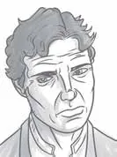

## Томас Долан, 44 года, бывший предприниматель



```stat
СИЛ 60    ВЫН 40    ТЕЛ 80    ЛВК 50    ИНТ 70
НАР 60    МОЩ 40    ОБР 50    Рассудок 40   ПЗ 12
БкУ: +1d4   Комплекция: 1   Скорость: 6    Удача: 20
ПМ: 8

Ближний бой (драка)   45% (22/9), урон 1d3 + БкУ
Уклонение             45% (22/9)

Навыки: Бухгалтерское дело 60%, Искусство/ремесло (игра на скрипке) 30%, Лазание 40%, Электрика 25%, Красноречие 50%, Запугивание 50%, Родной язык (английский) 50%, Юриспруденция 40%, Механика 40%, Управление тяжёлыми машинами 50%, Психология 40%.
```

*Прим. перев.: в оригинале Уклонение напечатано как «45% (12/5)»; доли исправлены по проценту (22/9). Возможно, опечатка в самом проценте и должно быть 25% (12/5) — половина ЛВК.*

### Биография

- **Внешность:** крепкий, краснолицый, с копной чёрных волос.
- **Идеалы и принципы:** мир может быть справедлив, но только если мы сами вершим справедливость. Иногда это очень похоже на месть.
- **Значимые люди:** Роско Моллой, ваш бывший служащий, который купил ваши старые фабрики и умудряется получать прибыль там, где вы прогорели. Теперь он делает вид, что вас не существует.
- **Важные места:** клочок земли у дороги, где вы докуриваете старые окурки сигар, смотрите на проезжающие машины и думаете о прошлом.
- **Ценное имущество:** старая скрипка вашего дяди, на которой вы любите играть, сидя у костра. Она поднимает всем настроение.
- **Черты:** не терпит дураков и взрывается, когда другие делают или говорят глупость.

Ваша история в эти тяжёлые времена не редкость, но вы пали ниже большинства. Вы ирландец во втором поколении и выросли в бедности в Бостоне. Тяжёлым трудом и деловой хваткой вы нашли возможности в текстильном деле и в итоге возглавили собственную компанию, владели несколькими фабриками и ткацкими цехами.

Потом, в 1929 году, рухнул фондовый рынок, и бо́льшая часть вашего состояния исчезла почти мгновенно. Вы начали было собирать всё заново, когда на вас обрушилась полоса невезения, а под конец — какая-то болезнь, от которой вы слабы и вялы. Конкуренты и кредиторы будто учуяли вашу слабость и за несколько месяцев разорвали вашу жизнь в клочья. Один из ваших бывших управляющих фабрикой, Роско Моллой, оказался наделён той хваткой, которую вы потеряли, и скупил что смог. Теперь он поднял ваше старое дело, но отгородился от вас, хотя именно вы дали ему первый шанс.

Теперь вы немногим лучше бродяги. Вы живёте в трущобах на окраине Кроули, штат Массачусетс, ставшего вам родным, среди десятков других, у кого, как и у вас, кончилась удача. Одно утешение — эти люди относятся друг к другу лучше, чем богачи и власть имущие, которых вы считали друзьями.

Вы твёрдо решили однажды вернуться в большую игру, и когда вернётесь, позаботитесь, чтобы никто из людей этого лагеря больше не мёрз и не голодал.

**Заметки игрока:** ____________________
