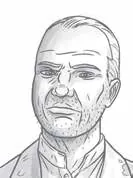

## Хайрам Мельник, 35 лет, бывший юрист



```stat
СИЛ 60    ВЫН 50    ТЕЛ 50    ЛВК 60    ИНТ 80
НАР 50    МОЩ 40    ОБР 70    Рассудок 40   ПЗ 10
БкУ: 0    Комплекция: 0    Скорость: 9    Удача: 20
ПМ: 8

Револьвер .38         60% (30/12), урон 1d10, дальность 15 м, атак в раунд 1 (3),
                      патронов 6, осечка 100
Ближний бой (драка)   25% (12/5), урон 1d3 + БкУ
Уклонение             30% (15/6)

Навыки: Бухгалтерское дело 40%, Оценка 40%, Обаяние 50%, Средства 1%, Вождение автомобиля 40%, Стрельба (пистолет) 40%, Запугивание 40%, Родной язык (английский) 70%, Иностранный язык (латынь) 50%, Юриспруденция 70%, Механика 30%, Убеждение 60%, Психология 50%, Внимание 45%.
```

*Прим. перев.: так в оригинале — шанс атаки револьвером 60%, а навык «Стрельба (пистолет)» в списке навыков — 40%.*

### Биография

- **Внешность:** невысокий, щуплый, лысеющий, обычно с кислым видом.
- **Идеалы и принципы:** в этом мире человек человеку волк, и процветают только сильные и безжалостные.
- **Значимые люди:** Нэнси Карвер, ваш бывший секретарь, которая тоже живёт в трущобах. Вы уже много лет питаете к ней чувства.
- **Важные места:** «Гринлиз» — дорогой дом с поместьем на окраине Кроули, который когда-то принадлежал вам. Ваш соперник по делу Каспер Бринк купил его, когда вы разорились.
- **Ценное имущество:** ваши старые автомобильные перчатки — напоминание о временах, когда вы катались по окрестностям на своём «Роллс-Ройсе Сильвер Гост».
- **Черты:** склонен к горьким жалобам и вообще к сетованиям на жизнь.

Когда-то у вас была самая преуспевающая юридическая практика в Кроули. Теперь вы спите, укрывшись пальто, на постели из старого картона. Каждую ночь вы перебираете подробности того, как это случилось, и каждую ночь едва можете это понять.

Конечно, на крахе рынка вы потеряли деньги. Все потеряли. И да, дела пошли медленнее: многие ваши клиенты оказались в трудном положении. И всё же работы должно было хватить, чтобы держаться. Соперничество с фирмой Каспера Бринка было здоровым — до тех пор, пока вы сами не перестали быть здоровым.

Когда здоровье стало сдавать, вы начали ошибаться. Давали клиентам плохие советы. Проигрывали дела, которые должны были выиграть без труда. Клиенты уходили от вас к Бринку, долги росли, и вы потеряли всё. Когда банк забрал ваш прекрасный дом «Гринлиз», его купил Бринк — вы гадаете, не было ли это просто способом ткнуть вас носом.

Теперь вы живёте в трущобах с десятками других людей, потерявших всё. Единственный просвет — то, что здесь же ваш бывший секретарь Нэнси Карвер. Вы годами молча обожали её; может быть, теперь, среди всей этой печали, наконец пришло время найти любовь.

**Заметки игрока:** ____________________
