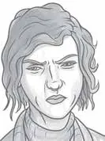

## Агата Пристли, 28 лет, бывшая журналистка



```stat
СИЛ 50    ВЫН 40    ТЕЛ 50    ЛВК 60    ИНТ 80
НАР 50    МОЩ 40    ОБР 70    Рассудок 40   ПЗ 9
БкУ: 0    Комплекция: 0    Скорость: 8    Удача: 20
ПМ: 8

Ближний бой (драка)   25% (12/5), урон 1d3 + БкУ
Уклонение             30% (15/6)

Навыки: Искусство/ремесло (фотография) 40%, Обаяние 40%, Средства 1%, Вождение автомобиля 40%, Красноречие 60%, История 50%, Родной язык (английский) 70%, Работа в библиотеке 60%, Слух 40%, Взлом 40%, Естествознание 30%, Оккультизм 35%, Психология 70%, Ловкость рук 40%, Внимание 50%, Скрытность 50%.
```

### Биография

- **Внешность:** когда-то высокая и стройная, с орлиными чертами лица, а теперь истощённая и измождённая. Носит дорогое кашемировое пальто, теперь рваное и потёртое.
- **Идеалы и принципы:** человеческое общество определяется справедливостью; без неё мы немногим лучше зверей.
- **Значимые люди:** ваш бывший редактор в «Кроули экзаминер» Норман Брансуик, который приучил вас к дисциплине и строгости в работе.
- **Важные места:** огород, за которым вы ухаживаете и который даёт жителям Гувервиля немного свежей еды.
- **Ценное имущество:** ваш альбом с вырезками множества статей, которые вы написали для «Экзаминера».
- **Черты:** упряма и своевольна, особенно когда дело касается поисков правды.

У вас было будущее. Ваша карьера журналистки шла в гору, и, пока вы ещё работали в местной газете Кроули, вам намекали на предложения от «Бостон глоуб» и даже от «Нью-Йорк таймс»! Потом мир сдвинулся.

Терять после краха фондового рынка вам было особенно нечего, но потерянного хватило, чтобы лишить вас всякой денежной уверенности. Когда вы и ваш муж Гарольд оба потеряли работу в газете из-за сокращений (так вам сказали), а потом тяжело заболели, вам оказалось не по силам даже сохранить крышу над головой. Теперь вы живёте в Гувервиле на окраине города.

Вы с Гарольдом познакомились в «Кроули экзаминер», где оба работали журналистами, и полюбили друг друга почти сразу. Ваша работа и личная жизнь переплелись, и вы часто писали вместе. В минуты подозрительности вы гадаете, не связано ли ваше падение с вопросами, которые Гарольд задавал о скрытном финансовом вундеркинде по имени Теодор Седжвик. Казалось, у того было влияние повсюду, — должно быть, и в «Экзаминере» тоже.

Теперь Гарольд тяжело болен. Доктор Кумбс в лагере делает всё, что может, но вы знаете, что ваш муж умирает, и никто не знает, что с ним. Вы сделаете что угодно, чтобы спасти его и узнать правду о том, что случилось с вами обоими.

**Заметки игрока:** ____________________
