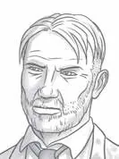

## Натаниэль Кумбс, 54 года, бывший врач



```stat
СИЛ 50    ВЫН 50    ТЕЛ 60    ЛВК 70    ИНТ 60
НАР 50    МОЩ 40    ОБР 80    Рассудок 40   ПЗ 11
БкУ: 0    Комплекция: 0    Скорость: 6    Удача: 20
ПМ: 8

Револьвер .38         35% (17/7), урон 1d10, дальность 15 м, атак в раунд 1 (3),
                      патронов 6, осечка 100, 6 патронов в запасе
Ближний бой (драка)   25% (12/5), урон 1d3 + БкУ
Уклонение             35% (17/7)

Навыки: Обаяние 50%, Средства 1%, Стрельба (пистолет) 35%, Первая помощь 70%, Родной язык (английский) 80%, Иностранный язык (латынь) 50%, Медицина 70%, Естествознание 40%, Психология 50%, Психоанализ 30%, Наука (фармакология) 50%, Наука (биология) 50%.
```

### Биография

- **Внешность:** рано постаревший и измождённый, с аккуратно подстриженной седой бородой. Всё ещё носит сильно запачканный белый халат.
- **Идеалы и принципы:** каждый человек заслуживает достоинства и сострадания, каково бы ни было его положение в жизни.
- **Значимые люди:** Билли Спитцер, мальчик, который помогает всем в медицинской лачуге. Его бодрость заразительна.
- **Важные места:** лачуга в трущобах, которую вы превратили в самую лучшую лечебницу, какую смогли. Сделать с ней можно немногое, но это лучше, чем ничего.
- **Ценное имущество:** перьевая ручка «Монблан Мастерпис», которую жена подарила вам в честь назначения директором больницы Бентама. Её можно было бы продать ради еды и лекарств, но вы не в силах с ней расстаться.
- **Черты:** шумная манера скрывает тёплую и незлопамятную натуру.

Не так давно вы были самым успешным врачом Кроули. Кроули, конечно, не так велик, как соседний Аркхэм, но вы были богаты и уважаемы. Когда вам предложили стать директором больницы Бентама, вам казалось, что все ваши планы сбываются.

Это было в начале 1929 года. Через несколько месяцев рынки рухнули, и ваша денежная уверенность исчезла. Оставшиеся деньги были вложены в больницу, и вы начали терять всё. Потом, когда вы меньше всего могли себе это позволить, вы заболели.

Болезнь была странной и не подходила ни под одну известную вам патологию. Вы стали вялым, иногда теряли сознание, мышцы начали усыхать. Между денежными трудностями и неспособностью работать вы потеряли дом, брак, практику и, наконец, друзей.

Теперь вы живёте в трущобах на окраине Кроули. Здесь есть и другие с похожими историями, и все они тоже больны. По правде говоря, вы один из самых здоровых здесь. Ваш старый протеже, доктор Кавендиш из больницы, кое-чем помогает, но на самом деле вы — самое близкое к врачу, что есть у этих людей, и они на вас полагаются. Жаль только, что у вас нет средств и сил, чтобы дать им нужную помощь, и умения распознать эту странную болезнь.

**Заметки игрока:** ____________________
