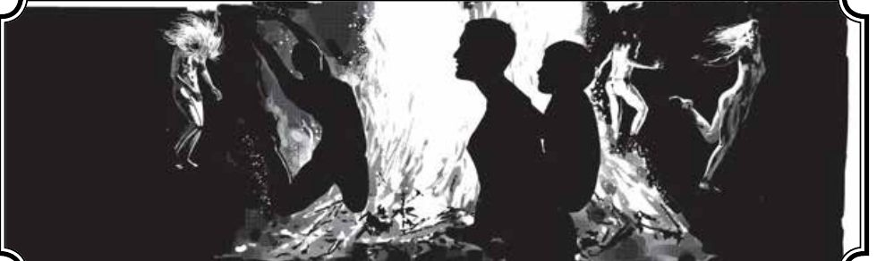

всех остальных его не существовало. Врачи сказали, что у Стейси ложная беременность. Боли и недомогание были вполне настоящими, и когда наконец она пережила роды — одна дома, и поддерживал её только Дэвид, — то, что появилось на свет, им обоим показалось младенцем-мальчиком. Они назвали мальчика Брэдли.

Стейси заботилась о своём призрачном младенце; Дэвид помогал ей и навещал всё реже. Поскольку рождение нигде не было записано, а ребёнка никто больше не видел, не было ни официальных записей, ни дел с властями. Деньгами Стейси обеспечивал Дэвид, хотя для его средств это было тяжело.

Скоро стало ясно, что Стейси не справляется. Её мучила вина за соучастие в смерти матери, особенно глубокой ночью, когда призрачный младенец бегло рассказывал ей о своих планах. Стейси всё это время поддерживала связь с Мари Кьюбин (одной из Тринадцати), и теперь Мари ощутила, что обязана вмешаться.

## Мари вмешивается

В девять месяцев Брэдли ходил и говорил, как одержимый демоном младенец. Мари видела, как всё это губит Стейси, и задумала отвезти ребёнка в безопасное место. Мари было ясно, что ребёнок — зло и что он угрожает всякому, кто с ним соприкоснётся, но всё же это был ребёнок. В своём высокомерии Мари решила, что её миссия — заботиться о ребёнке и воспитывать его, а может быть, даже изгнать сидящих в нём демонов. Она обсудила свои планы со Стейси и Дэвидом. Все согласились, что план Мари — лучший выход. Вернее, сами они того не знали, но согласился Брэдли — и внушил взрослым, будто это их собственная мысль.

Мари убеждена, что поступила правильно, забрав ребёнка в свой загородный дом и спрятав за прочной дверью подвала. Мари считает, что ребёнок угрожает человечеству и что, держа его взаперти, она совершает праведное дело. Пытаясь понять злую силу, она разговаривала с ребёнком и записывала то, что узнала. В этих разговорах Брэдли вкрался в разум Мари, пока его власть над ней не стала полной.

В помощь себе Мари призвала Натана Хелда (своего старого друга), который вскоре тоже попал под чары Брэдли. У Натана обширное собрание оккультной литературы, и Мари хотела использовать его, чтобы лучше понять Брэдли. Натан и Мари читали вслух отрывки из книг и проводили некоторые из описанных обрядов. Им казалось, что они всё лучше понимают Брэдли или пытаются изгнать злую силу, но на самом деле эти занятия были школой Брэдли.

## Метка Брэдли

У каждого из Тринадцати на правой ладони есть шрам — с той ночи в лесу. По мере того как влияние Брэдли крепнет, шрам горит и тянется вверх по руке к груди, как уже случилось у Дэвида, Стейси, Мари и Натана. Когда шрам доходит до груди, это необратимо. Если шрам удалить, ампутировав поражённую кисть или руку, персонаж сразу освобождается от злой силы, больше не подвластен Брэдли и не может его воспринимать (см. **«Ампутация»**, с. 166).

## План Брэдли

Брэдли хочет привести на службу себе каждого из Тринадцати. Однако одного из Тринадцати Брэдли найти не может. Этот неуловимый человек — Грег Дрейпер: его невозможно отыскать, потому что он потерял руку в несчастном случае. Брэдли не знает, что стало с Грегом, и не хочет поручать слугам выяснить это — боится, что так они найдут способ вырваться из-под его влияния.

Недавно он мысленно потянулся к оставшимся из Тринадцати, пытаясь исподволь направить каждого к себе. Он может насылать на каждого из Тринадцати галлюцинации — такие же, как галлюцинации безумия, описанные в «Книге хранителя» (см. **«Силы Брэдли»**, с. 148). Ещё Брэдли может пользоваться прямым каналом, который у него есть
