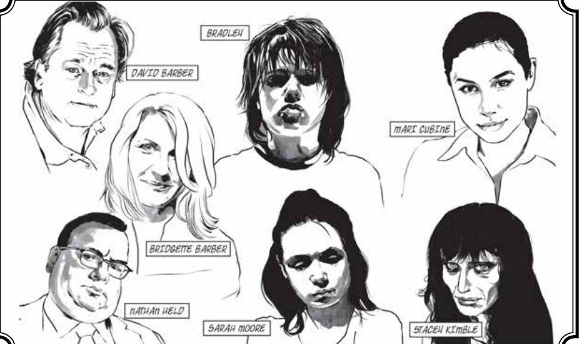

#### Что можно узнать о Дэвиде Барбере

- **Медицинские записи.** У Дэвида давняя психическая болезнь: в 1992 году ему поставили диагноз «шизофрения». С тех пор болезнь возвращалась, но обычно её удаётся сдерживать лекарствами. Жена Бриджит внимательно следит за его здоровьем.
- **Круг общения.** Дэвид несколько раз в месяц бывает в доме Мари, чтобы участвовать в магических обрядах и проведать Брэдли. Его знают несколько книготорговцев и продавцов оккультных принадлежностей.
- **Дом.** Домашняя жизнь Дэвида вращается вокруг жены Бриджит и сына Майкла. В его кабинете, в запертом шкафу, лежит его экземпляр книги «О природе чудовищ» и «книги теней» (тетради), написанные простым шифром, где записаны разные магические обряды, церемонии и практики. Сведения есть и на его настольном компьютере. Из-за паранойи Дэвида и его знания компьютеров добраться до его файлов трудно (нужна трудная проверка Работы с компьютером). При тщательном обыске дома можно найти и переписанную от руки копию книги, спрятанную среди вещей Майкла.
- **Работа.** На работе Дэвид держится привычно и уверенно, и в IT-среде никому не кажется чем-то необычным.
- **В сети.** Каждый месяц Дэвид даёт Бриджит деньги на хозяйство, а остальными распоряжается сам. В его интернет-банке есть записи о регулярных переводах на другой счёт (счёт Мари) — по несколько сотен фунтов в месяц. Каждый месяц Дэвид снимает двести фунтов наличными и отдаёт Саре.
- **Где бывает.** Днём Дэвид на работе, а остальное время делит между двумя домами — с женой или с Сарой. Изредка бывает в доме Мари. Иногда по ночам он уезжает с Анджеликой в укромное место.

### Бриджит Барбер

Бриджит изучала экономику в Нортгемптонском колледже и состояла в Оккультном обществе Нортгемптонского колледжа. После колледжа у неё родился сын (Майкл), и вскоре она вышла замуж за Дэвида. Бриджит всегда собиралась сделать карьеру, но отложила её, когда родился сын, а потом ещё раз — когда в восемь лет у него нашли рак. Сейчас Бриджит работает помощником учителя в местной школе.

Бриджит знает о психических проблемах Дэвида и заботится о нём. Она не знает ни о его изменах, ни о детях Дэвида вне брака. Бриджит верит в оккультное, но при этом в ней есть доля скептицизма, и порой она ловит себя на том, что подыгрывает убеждениям Дэвида. Она знает, что в последнее время Дэвид стал напряжённее.

**Описание.** Бриджит одевается элегантно и всегда носит на плечах какую-нибудь шаль.

**Черты.** У Бриджит сплошь тяжёлые взгляды и поджатые губы.
