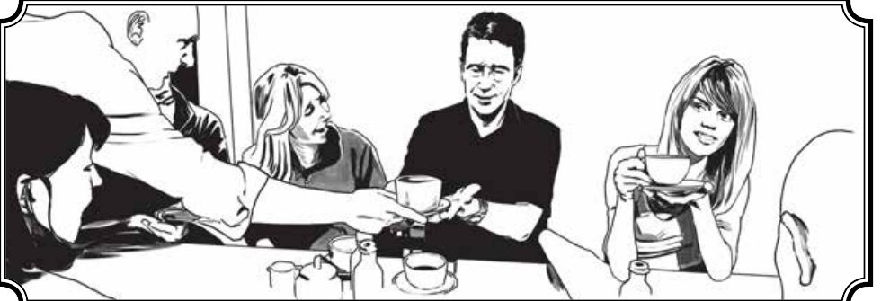
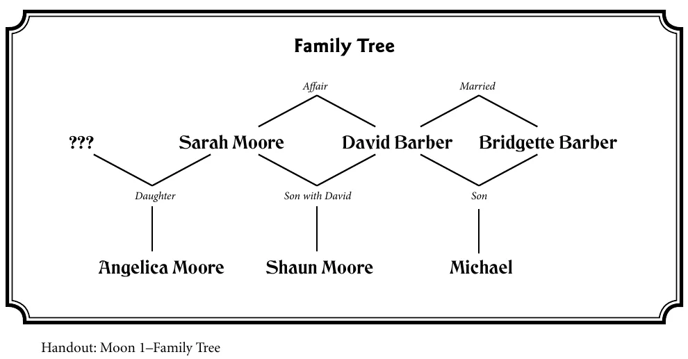

С этого момента и начинается игра. Ждите, что игроки начнут задавать вопросы — и Саре, и о положении дел в целом. Пока Сара рассказывает свою историю, показывайте **раздатку «Луна» 1: семейное древо**, чтобы пояснить разные отношения.

История Сары — отчаянная и непродуманная. Вряд ли Бриджит приняла бы в семью чужого ребёнка, и столь же сомнительно уверение Сары, будто Дэвид насылает проклятия на разных людей. Гэри даже не был одним из первых Тринадцати членов оккультного общества, хотя этого могут и не заметить.

*Прим. перев.: на листе Алисии Хуико (с. 175) Гэри назван членом общества; противоречия может и не быть — он мог быть рядовым членом, не из комитета Тринадцати.*

Играя Сару, смело присочиняйте и лгите. Она скажет что угодно, лишь бы сыщики взялись действовать в её интересах. Невысказанная тревога Сары — её дочь. Она знает, что у Дэвида роман с Анджеликой, и ни перед чем не остановится, чтобы его разрушить. Ни перед чем — кроме того, чтобы самой поговорить с ними начистоту: она знает, что это вобьёт клин между ней и дочерью. Если бы ей пришлось выбирать, она предпочла бы оставить себе Дэвида, а не дочь, но боится, что вот-вот случится худшее: она не только потеряет обоих, но они бросят её и будут смеяться над ней за её спиной.

Сара изо всех сил постаралась выглядеть прилично, но она худая, осунувшаяся и усталая. Это видно любому, а тот, кто присмотрится, может заметить признаки наркомании. Кто прямо скажет, что изучает Сару, должен пройти трудную проверку **Внимания** или **Психологии**; при успехе сыщик замечает признаки наркотической зависимости. Кроме того, у Сары синяк под глазом, хотя он уже немного сошёл. Его поставил ей Натан неделю назад, когда она обратилась к нему за помощью насчёт Дэвида. Если кто-то спросит о синяке, она намекнёт, что это сделал Дэвид, но успешная проверка Психологии покажет, что это ложь.

Если игрок Эрика (готовый сыщик) не упомянет о его раке, Сара может каким-то образом это почувствовать (её подтолкнёт Брэдли) и спросить Эрика, всё ли с ним в порядке.

> **Раздатка «Луна» 1: семейное древо**
>
> **Семейное древо**
>
> ??? — Сара Мур: дочь — Анджелика Мур
>
> Сара Мур — Дэвид Барбер: роман; сын от Дэвида — Шон Мур
>
> Дэвид Барбер — Бриджит Барбер: в браке; сын — Майкл
