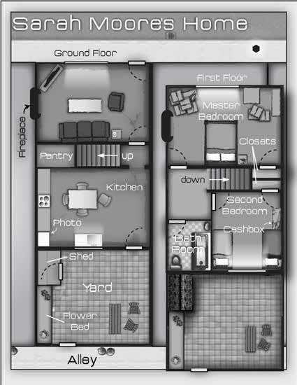

Как сказано в разделе **«Последние события»**, можно дать Саре рассказать о визите к Стейси уже в начальной сцене, а можно отложить это на потом. Если упомянуть об этом сейчас, у игроков будет больше сведений, и игра, возможно, пойдёт быстрее. По умолчанию Сара лишь упоминает, что Стейси в психиатрической больнице, но ещё не навещала её и не узнала о её истории с Дэвидом.

#### Вероятные действия после начальной сцены

Дальше у игроков есть несколько путей:

- Пойти домой к Саре, познакомиться с Шоном и Анджеликой и разузнать больше о положении дел (см. **«Дом Сары Мур»**, ниже).
- Навестить Дэвида и его семью (см. **«Дом Барберов»**, с. 160).
- Хотя на этом этапе это менее вероятно, они могут навестить Стейси в больнице (см. **«Стейси в больнице»**, с. 163).
- Собрать сведения о любом из персонажей (см. **«Сбор сведений»**, с. 164), в том числе гаданием (см. **«Таро и спиритическая доска»**, с. 145).
- Если сыщики решат не обращать внимания на историю Сары и ничего не делать, Брэдли каким-нибудь образом применит к ним свои силы (см. **«Силы Брэдли. 4. Галлюцинации»**, с. 149).

## Дом Сары Мур

*Подписи плана:* Ground Floor — первый этаж; Fireplace — камин; Pantry — кладовка; up — вверх; Kitchen — кухня; Photo — фотография; Shed — сарай; Yard — двор; Flower Bed — клумба; Alley — переулок; First Floor — второй этаж; Master Bedroom — главная спальня; Closets — шкафы; down — вниз; Second Bedroom — вторая спальня; Cashbox — шкатулка; Bath Room — ванная.

Сара живёт в доме с двумя спальнями в унылом жилом квартале вместе с дочерью (Анджеликой, подростком) и сыном (Шоном, 9 лет). Анджелики днём почти не бывает дома. Время Шона делится между школой и огромным телевизором, который Дэвид подарил ему на прошлое Рождество.

Дом тесный и грязный. Даже если Сара прибралась к приходу гостей, затёртый линолеум будет липким, а в труднодоступных местах — покрытым толстым слоем грязи. Всё ценное, кроме телевизора, уже продано, чтобы оплачивать героин Сары. По дому разлит странный приторно-сладкий запах; у него нет особого источника или значения, но в семейном доме его быть не должно.

Если сыщики обыщут дом, успешная проверка **Внимания** на кухне откроет фотографию, завалившуюся за холодильник. На ней Дэвид, Сара, Анджелика и Шон. Если Сара увидит фотографию, она придёт в ярость. Успешная трудная проверка **Внимания** при осмотре фотографии или проверка **Психологии** при виде реакции Сары укажет на подозрительную близость между Дэвидом и Анджеликой, намекающую на интимную связь.

Спальня Сары завалена мятой одеждой, раскиданной среди картонных коробок, которые стоят там, где их поставили при переезде. Коробки открывала только Сара — искала, что бы продать или заложить за наличные. Ценного почти не осталось. Здесь можно найти несколько оккультных книжек в мягкой обложке, но ничего примечательного. Обыскивать комнату Сары может быть опасно: при крахе или проваленной повторной проверке навыка сыщик может пораниться иглой (наркоманского) шприца. Успешная проверка **Внимания** откроет клочок бланка (с названием местной больницы), на котором от руки написано: «Стейси, палата 2».

Вторую спальню делят Анджелика и Шон. Здесь так же неубрано, полно сломанных, но ярких
