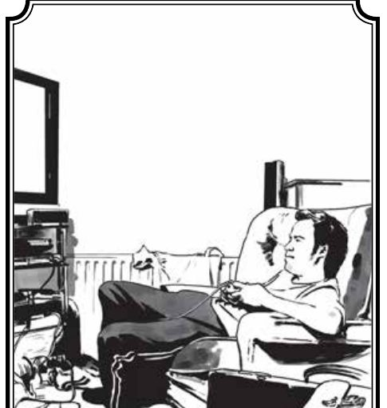

пластмассовых игрушек вперемешку со всем, чем живёт девочка-подросток. Все поверхности усеяны средствами для волос, рваными журналами, грязной одеждой и заброшенными учебниками. В основании кое-как собранного шкафа из готового набора спрятана запертая металлическая шкатулка для денег (найти её поможет успешная проверка **Внимания**). Здесь Анджелика прячет свои ценности. Тут можно найти доказательства её романа с Дэвидом: открытку от Дэвида ко Дню святого Валентина и серьги с подарочной биркой, на которой почерком Дэвида написано: «Моему цветочку, с любовью, Д.».

Дома Сара будет более напряжённой, чем в кафе, и если её задеть, может разозлиться и даже кинуться в драку. Или же она может уйти к себе в спальню и принять какой-нибудь наркотик. Сара будет и дальше лгать и манипулировать, добиваясь, чтобы сыщики разобрались с Дэвидом вместо неё. Как сказано в разделе **«Начальная сцена»**, её замысел не вполне разумен и не очень продуман.

Шон, если он не в школе, скорее всего, играет в видеоигру в гостиной. На взрослых он особого внимания не обращает. Сюда приходят разные люди — покупать, продавать и употреблять наркотики; Шон привык, что взрослые приходят и уходят, и они обычно почти его не замечают. Хранитель может заставить Брэдли ненадолго вселиться в Шона, если это нужно Брэдли (см. **«Силы Брэдли. 5. Одержимость»**, с. 149).

Если сыщики проведут какое-то время в доме Сары, скорее всего, при них домой придёт Анджелика. Она откроет дверь своим ключом и проверит Шона — поел ли он. В зависимости от времени суток она может принести ему поесть — еду навынос или что-нибудь, что можно разогреть в микроволновке. С сыщиками Анджелика, скорее всего, будет угрюмой и неразговорчивой. Она уйдёт к себе и долго будет собираться — то ли к друзьям, то ли на тайное свидание с Дэвидом Барбером.

Может случиться и так, что, пока сыщики здесь, зайдёт Дэвид Барбер или Натан Хелд. Дэвид бывает здесь несколько раз в неделю и удивится, застав тут сыщиков. Сара недавно связалась с Натаном, и неделю назад они встретились. Сара обратилась к Натану с той же историей, которой сейчас кормит сыщиков. Она надавила на Натана, и старая вражда всплыла на поверхность: Натан ударил её и ушёл. Если он вернётся теперь, он может притвориться, что беспокоится о ней, но в этом человеке на самом деле нет ни капли заботы, и он вряд ли благосклонно отнесётся к тем, кто лезет в то, что он считает своим делом.

#### Вероятные действия после этой сцены

- Навестить Дэвида и его семью (см. **«Дом Барберов»**, ниже).
- Навестить Стейси в больнице (см. **«Стейси в больнице»**, с. 163).
- Навестить Натана или Мари, если сыщики о них узнали (см. **«Дом Мари Кьюбин»**, с. 162, и **«Квартира Натана Хелда»**, с. 161).
- Собрать сведения о любом из персонажей (см. **«Сбор сведений»**, с. 164), в том числе гаданием (см. **«Таро и спиритическая доска»**, с. 145).
- Если сыщики решат не обращать внимания на историю Сары и ничего не делать, Брэдли каким-нибудь образом применит к ним свои силы (см. **«Силы Брэдли. 4. Галлюцинации»**, с. 149).

## Дом Барберов

Дэвид и его жена Бриджит живут с сыном Майклом в обычном двухквартирном доме с тремя спальнями в приятном, зелёном современном жилом квартале. Бриджит гордится своим домом и держит его в чистоте и порядке. В доме есть всё, что ожидаешь увидеть в современном доме среднего класса.

Главная спальня — Дэвида и Бриджит. Ничего примечательного здесь нет.

Во второй спальне живёт Майкл. Среди его вещей спрятана собственноручная копия «О природе чудовищ», которую он тайком переписал с отцовского оригинала. Майкл верит, что у него есть магические силы, но на самом деле его силы исходят от Брэдли. Майкл применил свои новообретённые магические силы к нескольким сверстникам. Одноклассник Джон Ролл разозлил Майкла и теперь ходит со сломанной ключицей — в спорт он вернётся не скоро. Брэдли ухватился за гнев Майкла, вселился в него и швырнул Джона через всю раздевалку. Свидетелей не было, а Джон слишком напуган, чтобы рассказать, что на самом деле случилось в тот день. В другой раз Майкла
