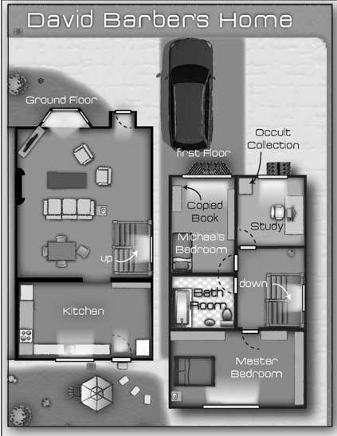

сильно потянуло к Холли Томас — одной из популярных девушек, которая, как считал Майкл, была ему не по зубам. Брэдли ухватился за возбуждение Майкла и вселился в него: заставил подойти к Холли и сказать ей именно те непристойности, которые она хотела услышать. С тех пор она встречается с Майклом, но когда между ними разгорается страсть, за руль всегда садится Брэдли. Майкл замечает, что иногда что-то делает и чувствует, будто смотрит на себя со стороны, но не понимает, что в него вселяется внешняя сила.

Самую маленькую из трёх спален Дэвид использует как кабинет; здесь его собрание оккультных книг и принадлежностей. Самые ценные книги и тетради Дэвида хранятся в запертом металлическом картотечном шкафу в кабинете. Самая ценная из этих книг — «О природе чудовищ».

Как сыщики представятся и что будут делать в доме Барберов, решать только им. Чтобы сыщикам было с чем бороться, можно изобразить Майкла и Холли неразумными и несговорчивыми. Если Майкл придёт в ярость, в него может вселиться Брэдли.

*Подписи плана:* Ground Floor — первый этаж; Kitchen — кухня; up — вверх; First Floor — второй этаж; Copied Book — переписанная книга; Michael’s Bedroom — спальня Майкла; Bath Room — ванная; Study — кабинет; Occult Collection — оккультное собрание; down — вниз; Master Bedroom — главная спальня.

#### Вероятные действия после этой сцены

- Пойти домой к Саре, познакомиться с Шоном и Анджеликой и разузнать больше о положении дел, если сыщики ещё этого не сделали (см. **«Дом Сары Мур»**, с. 159).
- Навестить Стейси в больнице (см. **«Стейси в больнице»**, с. 163).
- Навестить Натана или Мари, если сыщики о них узнали (см. **«Дом Мари Кьюбин»**, с. 162, и **«Квартира Натана Хелда»**, ниже).
- Собрать сведения о любом из персонажей (см. **«Сбор сведений»**, с. 164), в том числе гаданием (см. **«Таро и спиритическая доска»**, с. 145).
- Если сыщики решат не обращать внимания на историю Сары и ничего не делать, Брэдли каким-нибудь образом применит к ним свои силы (см. **«Силы Брэдли. 4. Галлюцинации»**, с. 149).

## Квартира Натана Хелда

У Натана маленькая квартира в центре города. Среди пустых коробок из-под еды навынос и пыльных стопок DVD можно найти запас ценных и редких оккультных книг. Тому, кто знает, что ищет, мелочи по всей квартире дадут улики: в настенном календаре рядом с назначенными встречами записаны имена Мари и Дэвида, а записи телефонных звонков и электронной почты дадут те же связи. В блокноте возле кровати — фотографии Анджелики в разном возрасте. Это не постановочные снимки: похоже, их сделали издалека телеобъективом, без её ведома. Собрание жутковатое, и неясно, говорит ли оно об отцовской любви или о чём-то более зловещем. Вместе с ним хранятся откровенные снимки Мари Кьюбин в разной степени раздетости. Она не знает, что эти фотографии существуют.

Можно найти коробку магнитофонных кассет; часть из них зажевал кассетный магнитофон Натана, который теперь лежит разобранным. Кассеты — часть
