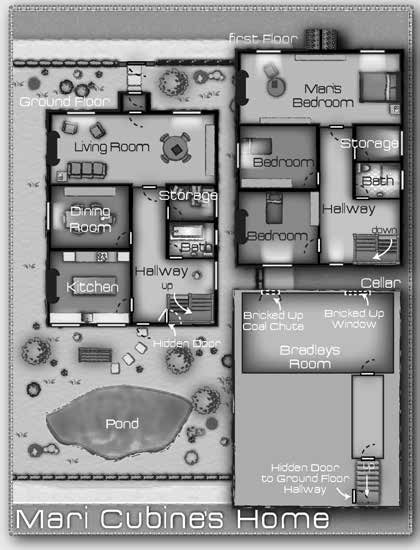

**«Записей Брэдли»** (см. с. 168). Похожие записи есть на его компьютере, а с ними — видеоролики допросов Брэдли. Смотреть эти ролики уже само по себе тяжело, но кроме издевательств в них есть оккультная сторона, и это требует проверки Рассудка (потеря 1/1d3). На компьютере Натана можно найти множество незаконных материалов, за которые его посадили бы, если передать их полиции.

#### Вероятные действия после этой сцены

- Можно считать, что сыщики уже побывали у Сары и Дэвида.
- Сообщить о Натане в полицию (см. **«Мы вызываем полицию»**, с. 165).
- Навестить Стейси в больнице (см. **«Стейси в больнице»**, с. 163).
- Навестить Мари, если сыщики о ней узнали (см. **«Дом Мари Кьюбин»**, ниже).
- Собрать сведения о любом из персонажей (см. **«Сбор сведений»**, с. 164), в том числе гаданием (см. **«Таро и спиритическая доска»**, с. 145).
- Если сыщики решат ничего не делать, Брэдли каким-нибудь образом применит к ним свои силы (см. **«Силы Брэдли. 4. Галлюцинации»**, с. 149).

## Дом Мари Кьюбин

*Подписи плана:* Ground Floor — первый этаж; Living Room — гостиная; Dining Room — столовая; Kitchen — кухня; Storage — кладовая; Bath — ванная; Hallway — коридор; up — вверх; Hidden Door — потайная дверь; Pond — пруд; First Floor — второй этаж; Mari’s Bedroom — спальня Мари; Bedroom — спальня; down — вниз; Cellar — подвал; Bricked Up Coal Chute — заложенный кирпичом угольный жёлоб; Bricked Up Window — заложенное кирпичом окно; Bradley’s Room — комната Брэдли; Hidden Door to Ground Floor Hallway — потайная дверь в коридор первого этажа.

Мари работает в банке и хорошо зарабатывает. Она живёт в отдельном доме на краю деревни. У дома толстые каменные стены и большой сад, который по большей части оставлен зарастать. Сам дом чист до спартанской строгости. Брэдли держат в подвале, и случайным гостям его присутствие незаметно.

Кухня хорошо снабжена для одного человека: отличные продукты, дорогие вина и подборка модных кулинарных книг. Но один шкаф забит банками спагетти-колечек — единственной едой Брэдли. Ему не нужно есть, но ему выгодно позволять слугам кормить себя. В посудомоечной машине несколько мисок из нержавеющей стали, какие ставят собакам, но никаких признаков домашнего животного в доме нет (миски — для Брэдли). Можно найти флакон сильного успокоительного (в жидком виде), которое иногда подмешивают в еду Брэдли, чтобы его утихомирить; на деле успокоительное на Брэдли не действует, и он лишь подыгрывает этой комедии ради забавы. Кроме того, Брэдли знает, что еда и лекарства создадут впечатление, будто он настоящий мальчик, если сюда явится ещё кто-то из Тринадцати.

В глубине прихожей есть потайная дверь, загороженная высоким напольным зеркалом; чтобы заметить дверную коробку в деревянной обшивке, нужна проверка **Внимания**. За потайной дверью — пролёт каменных ступеней. Сыщики могут заметить и то, что потайная дверь с обратной стороны обита прибитыми полотенцами (для звукоизоляции). За дверью у подножия лестницы — короткий коридор, ведущий ко второй тяжёлой деревянной двери. Внизу этой двери небольшая металлическая щель, через которую Брэдли подают еду. В двери проделано несколько глазков. Брэдли держат в подвальной комнате семь лет. Стены — из толстого камня, а маленькое окошко под потолком давно заложили кирпичом. Условия убогие.

Если сыщики встретят Брэдли в доме, он будет изображать невинность и страх перед незнакомцами. Он хитёр и знает, что люди поймут (хотя всё равно ужаснутся), почему пленный
